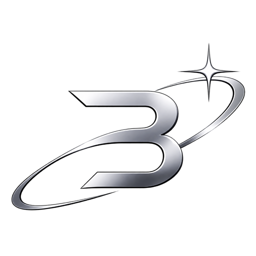
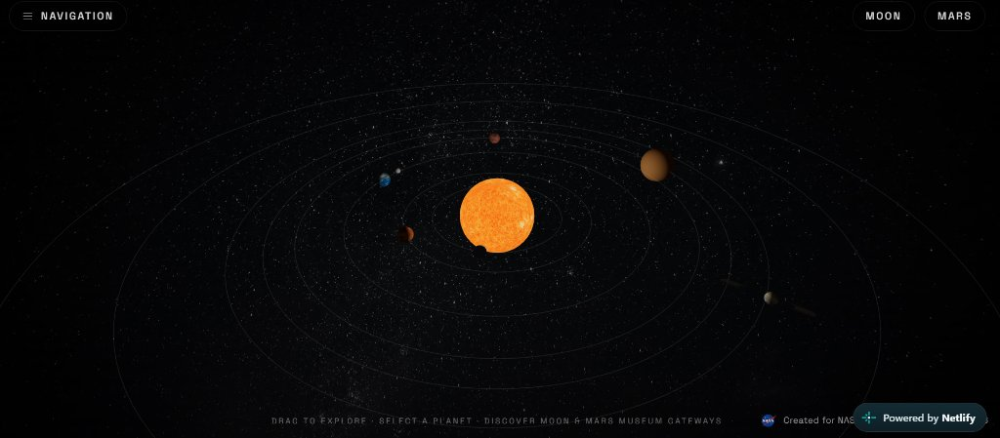
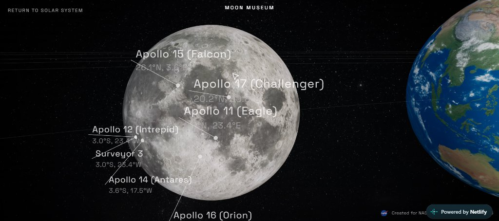
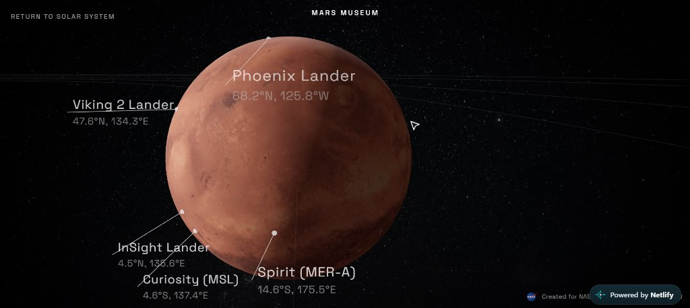
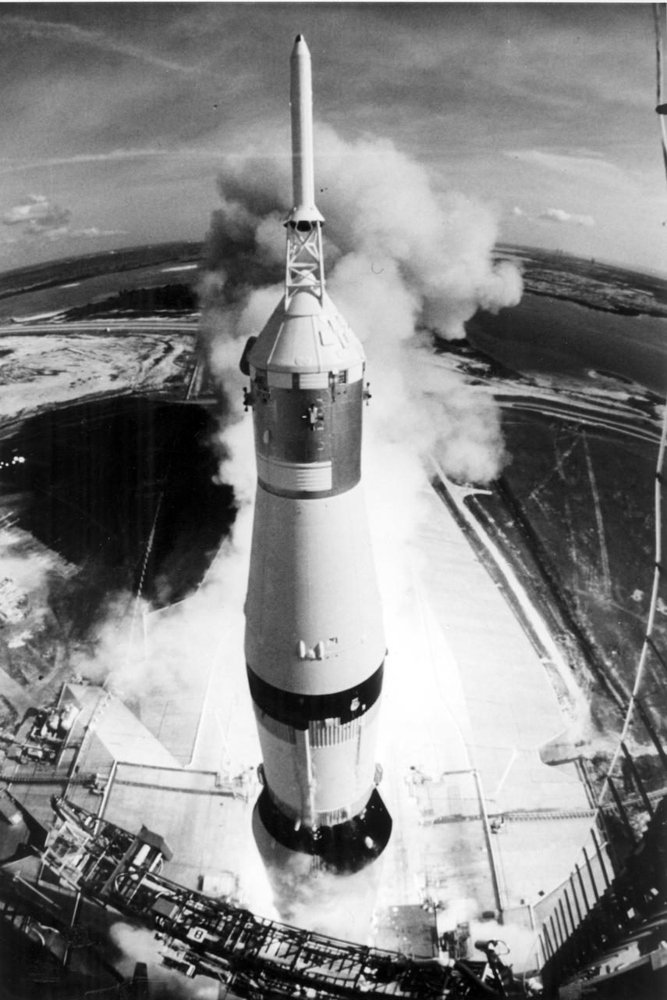
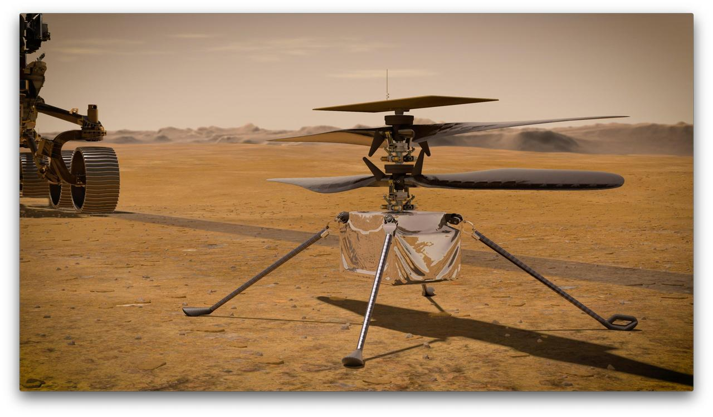
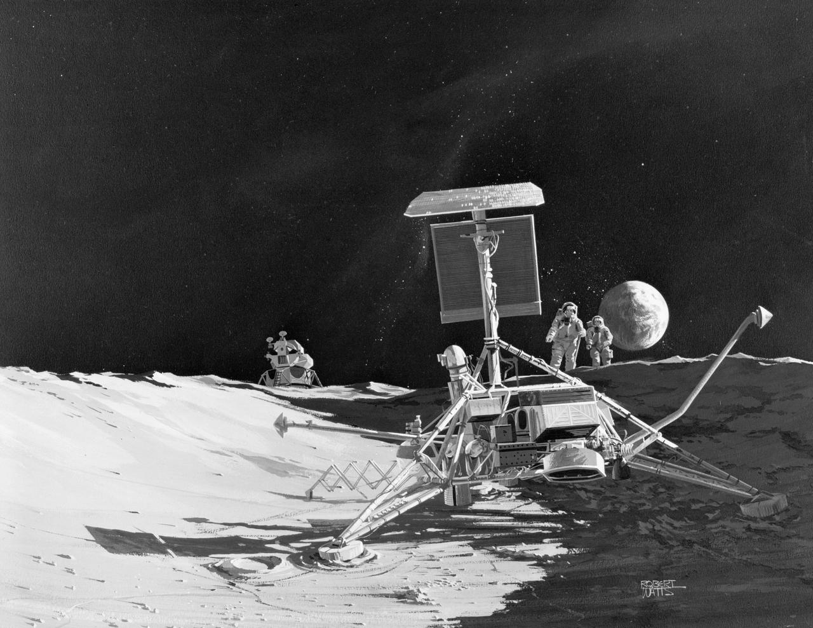
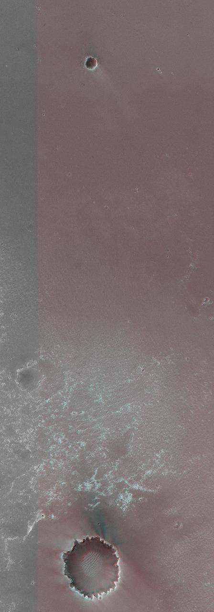
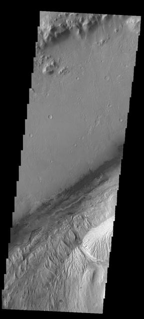

<div align="center">

<a href="https://beyondthemission.netlify.app/">
  
</a>

# Beyond the Mission

**NASA Space Apps Challenge 2026 — Global Hackathon Submission**  
*Challenge Track: Abandoned but not Forgotten*

### [🚀 Visit Beyond the Mission](https://beyondthemission.netlify.app/)

<p align="center">
  <strong>An immersive, cinematic 3D web museum honoring humanity’s robotic pioneers and abandoned exploration machines on the Moon and Mars.</strong>
</p>

<p align="center">
  <em>"Humanity may leave its machines behind, but it should never leave their stories forgotten."</em>
</p>

[](https://beyondthemission.netlify.app/)
[](https://www.spaceappschallenge.org/)
[](https://nextjs.org/)
[](https://react.dev/)
[](https://threejs.org/)
[](https://www.typescriptlang.org/)
[](./LICENSE)
[](https://github.com/AnasAbbasii/Nasa-Space-Apps-2026/actions)

<br/>

[🚀 Experience Live App](https://beyondthemission.netlify.app/) • [Documentation PDF](./documentation/Beyond_the_Mission_Complete_Documentation.pdf) • [Architecture Guide](./docs/03-project-architecture.md) • [Getting Started](#-getting-started) • [Screenshots](#-website-interface-gallery)

</div>

---

## 🌐 Live Demo

The official production deployment is hosted live on Netlify with automated continuous deployment from the `main` branch:

👉 **[https://beyondthemission.netlify.app/](https://beyondthemission.netlify.app/)**

- **Direct Experience URL:** [https://beyondthemission.netlify.app/experience](https://beyondthemission.netlify.app/experience)
- **Interactive 3D Solar System:** Real-time planetary orbits, camera transitions, and astronomical telemetry.
- **Dedicated Moon Museum:** Verified landing sites for Apollo 11–17 and Surveyor 3 with laser HUD callouts.
- **Dedicated Mars Museum:** High-resolution surface models and historical dossiers for 9 robotic missions.
- **Cinematic Narration:** Full documentary video player with synchronized voice narration, draggable speed slider, and subtitles.

---

## 🌌 Project Overview

**Beyond the Mission** is an interactive 3D digital monument created for the **NASA Space Apps Challenge 2026** by Team **Fortes In Ignoto**.

Across sixty years of interplanetary exploration, humanity has dispatched dozens of orbiters, landers, and rovers into the solar system. When their scientific missions conclude, their batteries drain, or Martian dust covers their solar arrays, these machines remain behind — frozen in the silence of deep space.

<p align="center">
  <a href="https://beyondthemission.netlify.app/">
    
  </a>
  <br/>
  <em>Real-time 3D Solar System simulation featuring planetary orbital paths, celestial tracking, and gateways to the Moon and Mars museums.</em>
</p>

### Key Highlights
1. **Interactive 3D Solar System:** A real-time orbital simulation of the Sun and planets with scientifically calibrated axial tilts, orbital velocities, and smooth camera tracking.
2. **High-Precision Planetary Museums:** 3D spherical maps of **Earth's Moon** and **Mars**, featuring 16 cataloged historical missions pinned to their exact NASA-verified coordinates.
3. **Cinematic Storytelling Engine:** Full-screen documentary video experiences featuring authentic NASA archival imagery, voice narration, synchronized progress bars, and single-line sequential captions.
4. **Interactive Playback Speed Slider & Double-Click Skip:** Draggable `0.5x` to `2.0x` speed control and responsive double-click gesture for rapid slide transitions.
5. **Spatial HUD Callouts:** Non-occluding laser-style HUD lines and responsive dossiers detailing mission duration, landing coordinates, scientific legacy, and why each artifact remained behind.

---

## 🌕 Moon Exploration Museum

The Moon Museum reconstructs the surface of Earth’s Moon, pinpointing the permanent resting places of the Apollo lunar descent stages and robotic survey craft.

<p align="center">
  <a href="https://beyondthemission.netlify.app/experience">
    
  </a>
  <br/>
  <em>The Moon Museum: High-resolution lunar surface rendering with laser HUD markers for Apollo 11–17 and Surveyor 3, with Earth rising in the background.</em>
</p>

### Cataloged Lunar Missions (7 Historic Sites)
| Mission / Machine | Landing Site | Coordinates | Active Dates | Historical Significance |
| :--- | :--- | :--- | :--- | :--- |
| **Apollo 11 (Eagle)** | Mare Tranquillitatis | 0.674° N, 23.473° E | Jul 20–21, 1969 | First crewed lunar landing; descent stage left as permanent memorial |
| **Apollo 12 (Intrepid)** | Oceanus Procellarum | 3.012° S, 23.422° W | Nov 19–20, 1969 | Pinpoint landing 163 m from Surveyor 3; retrieved returned parts |
| **Apollo 14 (Antares)** | Fra Mauro Formation | 3.645° S, 17.471° W | Feb 5–6, 1971 | First exploration of lunar highlands; modular equipment transporter |
| **Apollo 15 (Falcon)** | Hadley-Apennine | 26.132° N, 3.634° E | Jul 30 – Aug 2, 1971 | First Lunar Roving Vehicle (LRV); Genesis Rock discovery |
| **Apollo 16 (Orion)** | Descartes Highlands | 8.973° S, 15.500° E | Apr 21–24, 1972 | Highland volcanism investigation; ultraviolet camera deployment |
| **Apollo 17 (Challenger)**| Taurus-Littrow | 20.191° N, 30.772° E | Dec 11–14, 1972 | Longest crewed surface stay (75 h); Harrison Schmitt scientist-astronaut |
| **Surveyor 3** | Oceanus Procellarum | 3.016° S, 23.418° W | Apr 20, 1967 – May 4, 1967 | Robotic trenching proving lunar soil could support human weight |

---

## 🔴 Mars Exploration Museum

The Mars Museum presents an interactive 3D model of the Red Planet, honoring humanity's most ambitious robotic surface explorers across six decades of Martian exploration.

<p align="center">
  <a href="https://beyondthemission.netlify.app/experience">
    
  </a>
  <br/>
  <em>The Mars Museum: Interactive 3D Martian sphere featuring robotic landers and rovers from Viking 2 and Phoenix to Curiosity, Spirit, and InSight.</em>
</p>

### Cataloged Martian Missions (9 Historic Pioneers)
| Mission / Machine | Landing Site | Coordinates | Active Dates | Historical Significance |
| :--- | :--- | :--- | :--- | :--- |
| **Viking 1** | Chryse Planitia | 22.48° N, 312.05° E | Jul 20, 1976 – Nov 11, 1982 | First successful prolonged US Mars surface operations; biological tests |
| **Viking 2** | Utopia Planitia | 48.27° N, 134.02° E | Sep 3, 1976 – Apr 11, 1980 | High-latitude seismic and atmospheric analysis in polar terrain |
| **Mars Pathfinder & Sojourner** | Ares Vallis | 19.33° N, 326.45° E | Jul 4, 1997 – Sep 27, 1997 | First micro-rover on Mars; demonstrated airbag landing architecture |
| **Spirit (MER-A)** | Gusev Crater | 14.57° S, 175.47° E | Jan 4, 2004 – Mar 22, 2010 | Uncovered pure silica deposits indicating ancient hydrothermal vents |
| **Opportunity (MER-B)**| Meridiani Planum | 1.95° S, 354.47° E | Jan 25, 2004 – Jun 10, 2018 | Traversed 45.16 km over 14+ years; discovered hematite "blueberries" |
| **Phoenix** | Vastitas Borealis | 68.22° N, 234.25° E | May 25, 2008 – Nov 2, 2008 | Direct confirmation of water-ice and perchlorate salts in arctic soil |
| **Curiosity (MSL)** | Gale Crater | 4.59° S, 137.44° E | Aug 6, 2012 – Present | Nuclear-powered rover proving Gale Crater was once habitable |
| **InSight** | Elysium Planitia | 4.50° N, 135.62° E | Nov 26, 2018 – Dec 15, 2022 | First planetary geophysics station; detected 1,300+ marsquakes |
| **Perseverance & Ingenuity** | Jezero Crater | 18.38° N, 77.58° E | Feb 18, 2021 – Present | Seeking signs of ancient biosignatures; first powered extraterrestrial flight |

---

## 🛸 Abandoned Equipment: Archival Showcase

Every piece of machinery featured in Beyond the Mission was crafted with human ingenuity and left behind on alien worlds. Below is a selection of the authentic NASA archival photography preserved in the application:

<div align="center">

| Apollo 11 Lunar Module (*Eagle*) | Perseverance Rover & Ingenuity Helicopter | Surveyor 3 Robotic Lunar Lander |
| :---: | :---: | :---: |
|  |  |  |
| **Mare Tranquillitatis (July 1969)**<br/>*Humanity's first extraterrestrial campsite* | **Jezero Crater (February 2021)**<br/>*Ancient river delta exploration & powered flight* | **Oceanus Procellarum (April 1967)**<br/>*Robotic precursor visited by Apollo 12* |

| Opportunity Rover (*MER-B*) | Curiosity Rover (*MSL*) |
| :---: | :---: |
|  |  |
| **Meridiani Planum (2004–2018)**<br/>*Traversed 45.16 kilometers over 5,111 Martian sols* | **Gale Crater (2012–Present)**<br/>*Mount Sharp ascent & organic chemistry detection* |

</div>

---

## 🎬 Interactive Storytelling & Playback Controls

When exploring any mission dossier, clicking **"Experience Cinematic Story"** initiates an immersive documentary presentation featuring archival photography, spatial audio narration, and interactive controls:

```text
┌────────────────────────────────────────────────────────────────────────┐
│  ◄ BACK TO MUSEUM                  APOLLO 11 (EAGLE)            [ ✕ ] │
│                                                                        │
│                      [ ARCHIVAL DOCUMENTARY VISUAL ]                   │
│                                                                        │
│      "Tranquility Base here. The Eagle has landed."                    │
│  ────────────────────────────────────────────────────────────────────  │
│  [ ▶ / ❚❚ ]   ◄◄   01 / 13   ►►   ───●────── 1.0x   🔊 [===|===] 70%  │
└────────────────────────────────────────────────────────────────────────┘
```

### Key Playback Features:
- **Double-Click Slide Skipping:** Double-clicking anywhere on the slide display area instantly advances to the next slide with smooth cross-fade animation.
- **Draggable Playback Speed Slider:** A responsive horizontal slider allows fine control over video and narration speed from **`0.5x` to `2.0x`** (in `0.25x` increments) with live numerical indicator.
- **Synchronized Audio & Subtitles:** Audio streams from the custom Web Audio engine, synchronized with line-by-line subtitles and a progress bar.
- **Keyboard Shortcuts:** Press <kbd>Space</kbd> to play/pause, <kbd>Esc</kbd> to return to the 3D museum view.

---

## 🖼️ Website Interface Gallery

A visual tour of the primary interfaces available in **Beyond the Mission**:

<div align="center">

### 1. Solar System Orbital Gateway
<a href="https://beyondthemission.netlify.app/">
  
</a>
<p><em>Real-time interactive Keplerian orbits with planetary speed scaling, drag-to-orbit controls, and quick navigation HUD.</em></p>

<br/>

### 2. Lunar Surface & Apollo Landing Sites
<a href="https://beyondthemission.netlify.app/experience">
  
</a>
<p><em>High-precision lunar sphere displaying verified coordinates for Apollo 11–17 and Surveyor 3 with Earth context.</em></p>

<br/>

### 3. Martian Surface & Robotic Explorers
<a href="https://beyondthemission.netlify.app/experience">
  
</a>
<p><em>Interactive Mars sphere highlighting Viking 2, Phoenix, InSight, Curiosity, and Spirit with responsive mission dossiers.</em></p>

</div>

---

## 🛠️ Technology Stack

| Layer | Technology | Version | Purpose |
| :--- | :--- | :--- | :--- |
| **Framework** | [Next.js (App Router)](https://nextjs.org/) | `16.4.6` | Server-side rendering, API routes, Turbopack bundling |
| **Frontend Core** | [React](https://react.dev/) | `19.3.0` | Declarative UI, state orchestration, React 19 compiler compatibility |
| **3D Graphics** | [Three.js](https://threejs.org/) | `0.187.0` | WebGL scene graph, geometry, materials, PBR shaders |
| **R3F Ecosystem** | [@react-three/fiber](https://docs.pmnd.rs/react-three-fiber) | `9.8.2` | React declarative wrapper for Three.js canvas |
| **R3F Utilities** | [@react-three/drei](https://github.com/pmndrs/drei) | `10.7.9` | Camera controls, screen-space Line2 shaders, texture loading |
| **Styling** | [Tailwind CSS](https://tailwindcss.com/) | `4.3.3` | Utility-first styling with `@tailwindcss/turbopack` |
| **Language** | [TypeScript](https://www.typescriptlang.org/) | `5.0+` | End-to-end strict type-checking |
| **Audio Engine** | Web Audio API / Voice Studio | Custom | Streaming voice synthesis & synchronized audio playback |
| **CI / CD** | GitHub Actions | v4 | Automated linting, type-checking, and production builds |

---

## 🏗️ Architecture & Component Hierarchy

```text
appfolder/
├── .github/workflows/ci.yml       # GitHub Actions CI workflow (lint, typecheck, build)
├── app/
│   ├── api/narration/route.ts     # OpenAI-compatible streaming TTS endpoint
│   ├── experience/page.tsx        # Dynamic client mount for 3D experience
│   ├── globals.css                # Cosmic styling, animations, Tailwind directives
│   ├── layout.tsx                 # Root layout with Space Grotesk font injection
│   └── page.tsx                   # Atmospheric cinematic landing portal
├── components/
│   ├── cursor/CustomCursor.tsx    # Hardware-accelerated custom cursor
│   ├── experience/
│   │   ├── Experience.tsx         # Unified 3D Canvas, camera director, UI overlay
│   │   ├── ExperienceRoot.tsx     # SSR-safe dynamic wrapper with preloader
│   │   ├── hud/                   # Minimalist HUD, coordinates & telemetry
│   │   ├── mars/
│   │   │   ├── Mars.tsx           # High-res Mars sphere with coordinates math
│   │   │   ├── MarsCallouts.tsx   # Screen-space Line2 HUD markers for Mars rovers
│   │   │   └── MarsPanel.tsx      # Slide-out glassmorphic rover dossier
│   │   ├── moon/
│   │   │   ├── Moon.tsx           # High-res Moon sphere with coordinates math
│   │   │   ├── DynamicCallouts.tsx# Screen-space Line2 HUD markers for Apollo sites
│   │   │   └── PlanetInfoPanel.tsx# Slide-out Apollo mission dossier
│   │   ├── solar/
│   │   │   ├── SolarSystem.tsx    # Sun + 6 planets with orbital physics
│   │   │   └── SolarSidebar.tsx   # Planetary telemetry drawer
│   │   └── storytelling/
│   │       └── StorytellingView.tsx# Documentary player with speed slider & double-click
├── docs/                          # Architectural and technical documentation chapters
│   └── images/                    # Project screenshots and archival imagery
├── documentation/                 # Full NASA publication PDF (45+ pages) & source
├── lib/
│   ├── audio.ts                   # Web Audio helper and fallback synthesizers
│   └── voice-studio.ts            # Voice Studio integration with retry logic
├── public/
│   ├── 3dmodels/                  # 3D planet assets and textures
│   ├── icon.png                   # Official project logo
│   └── stories/                   # Curated archival photography for all 16 missions
├── .env.example                   # Environment configuration template
├── package.json                   # Dependencies and npm scripts
└── tsconfig.json                  # Strict TypeScript compiler options
```

---

## 🚀 Getting Started

Follow these instructions to clone, configure, and run the project locally on your machine.

### Prerequisites
- **Node.js**: `v20.x` or `v22.x` (LTS recommended)
- **npm**: `v10.x` or higher (bundled with Node.js)
- **Modern Browser**: Chrome 120+, Edge 120+, Firefox 120+, or Safari 17+ with WebGL2 support.

### 1. Clone the Repository
```bash
git clone https://github.com/AnasAbbasii/Nasa-Space-Apps-2026.git
cd Nasa-Space-Apps-2026
```

### 2. Install Dependencies
```bash
npm ci
```
*(Alternatively, use `npm install` if not using lockfile-strict installation).*

### 3. Configure Environment Variables
Copy the example environment configuration:
```bash
cp .env.example .env.local
```
*(On Windows Command Prompt: `copy .env.example .env.local`; on PowerShell: `Copy-Item .env.example .env.local`).*

The default configuration is ready for immediate standalone execution. Local Voice Studio audio synthesis is optional — if not active, the system automatically uses pre-cached audio or high-fidelity Web Speech fallback.

| Variable | Default Value | Description |
| :--- | :--- | :--- |
| `VOICESTUDIO_BASE_URL` | `http://127.0.0.1:3900/v1` | Local Voice Studio OpenAI-compatible TTS endpoint |
| `VOICESTUDIO_API_KEY` | `voicestudio` | API authorization key |
| `VOICESTUDIO_MODEL` | `tts-1` | Target TTS synthesis model |
| `VOICESTUDIO_VOICE` | `default` | Voice persona selector |
| `VOICESTUDIO_MODE` | `storytelling` | Audio tuning profile |
| `VOICESTUDIO_PERSONALITY` | `narrator` | Narrative style |
| `VOICESTUDIO_INSTRUCT` | `middle-aged, low pitch`| Vocal direction and pitch instruction |

### 4. Launch Development Server
```bash
npm run dev
```
Open your browser and navigate to [http://localhost:3000](http://localhost:3000).

### 5. Production Build & Verification
To test the production build locally with Turbopack:
```bash
npm run build
npm run start
```

---

## 🎮 Interactive Controls & Navigation

- **Solar System Orbit:** Click and drag left mouse button to orbit the camera around the solar system. Scroll to zoom in/out.
- **Select Planet:** Click on any orbiting planet or use the planetary selector in the sidebar to initiate a smooth camera flight to that world.
- **Museum Focus Mode:** When entering the Moon or Mars museum:
  - **Slow Rotation:** Planets rotate at a relaxed, steady rate (`0.0006 rad/frame`) for comfortable inspection.
  - **Pause-on-Hover:** Hovering over the planet or any machine marker automatically pauses rotation. Moving away smoothly resumes rotation without coordinate jumping.
  - **Marker Interaction:** Click on any glowing HUD marker to open the mission dossier and inspect verified telemetry.
- **Cinematic Storytelling:** In any mission panel, click **"Experience Cinematic Story"** to launch the full-screen documentary player:
  - **Double-Click:** Skip current slide immediately to advance the presentation.
  - **Speed Slider:** Drag horizontal slider from `0.5x` to `2.0x` (step `0.25x`) for variable playback speed.
  - **Spacebar / Click:** Pause or resume narration and slide progression.
  - **Progress Bar:** Real-time tracking bar synchronized with the voice narration.
  - **Captions:** Clean, single-line sequential captions updating sentence by sentence.
  - **Escape / Close Button:** Return smoothly to the 3D museum view.

---

## 📚 Complete Project Documentation

In addition to this README, comprehensive technical documentation is available:
- 📕 [**Complete Project Documentation PDF**](./documentation/Beyond_the_Mission_Complete_Documentation.pdf) — A 45+ page publication-ready document with technical tables, coordinate mathematics, and mission logs.
- 📝 [**Documentation Source Markdown**](./documentation/Beyond_the_Mission_Documentation_Source.md) — Raw markdown source of the complete technical report.
- 📑 [**Project Documentation Chapters (`docs/`)**](./docs):
  - [01 — Project Overview](./docs/01-project-overview.md)
  - [02 — Technology Stack](./docs/02-technology-stack.md)
  - [03 — Project Architecture](./docs/03-project-architecture.md)
  - [04 — Features & User Experience](./docs/04-features-and-user-experience.md)
  - [05 — 3D Assets & Scientific Data](./docs/05-assets-and-scientific-data.md)
  - [06 — Application Workflows](./docs/06-application-workflows.md)
  - [07 — Visual Design & Typography](./docs/07-visual-design.md)
  - [08 — Setup & Installation](./docs/08-setup-and-installation.md)
  - [09 — Implementation Status](./docs/09-implementation-status.md)
  - [10 — Future Development Roadmap](./docs/10-future-development.md)

---

## 🔧 Troubleshooting Guide

| Issue | Cause | Resolution |
| :--- | :--- | :--- |
| **WebGL Context Lost** | GPU memory saturation or driver timeout | Reload the browser tab. The app includes automatic context-loss recovery in `Experience.tsx`. Ensure hardware acceleration is enabled in browser settings. |
| **Audio Does Not Play Automatically** | Browser autoplay policy requires user gesture | Click anywhere on the screen or press the Play button to unlock the Web Audio context. |
| **Port 3000 In Use** | Another process is listening on port 3000 | Run `npm run dev -- -p 3001` to bind Next.js to an alternate port. |
| **Textures Black on Initial Load** | Asynchronous texture fetch delay | High-resolution 8K/4K planetary textures are preloaded; refresh once to populate browser cache. |
| **Script Execution Disabled (Windows)** | PowerShell execution policy restriction | Use `npm.cmd` / `npx.cmd` or run PowerShell with `-ExecutionPolicy Bypass`. |

---

## 👥 Team Fortes In Ignoto

Submitted for the **NASA Space Apps Challenge 2026**.

- **Anas Abbasi**
- **Ali Haider**
- **Ali Ahmed**
- **Hassaan Naveed Abbasi**

---

## 📄 License

This project is licensed under the terms of the [MIT License](./LICENSE).

*NASA imagery, textures, and mission telemetry are courtesy of the National Aeronautics and Space Administration (NASA), Jet Propulsion Laboratory (JPL), and Arizona State University (LROC).*
