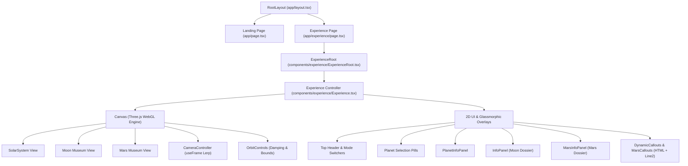
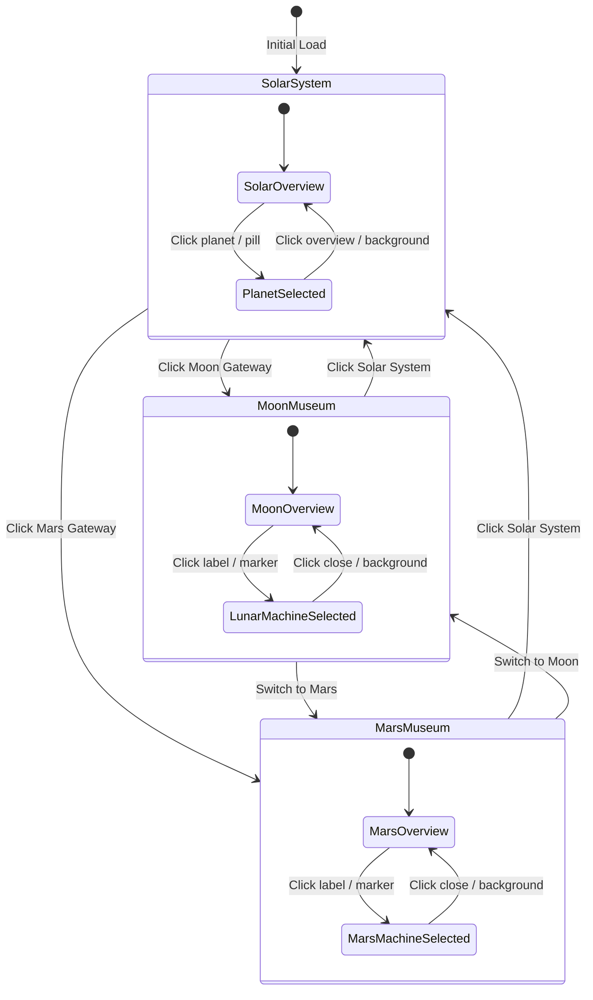

# 03 — Project Architecture

This document describes the application architecture, folder structure, component hierarchy, data flow, and 3D rendering pipeline of **The Museum of Forgotten Machines**.

---

## 1. High-Level Architectural Pattern
The application follows a **modular, client-orchestrated 3D single-page architecture** built on the Next.js App Router. The architecture strictly separates:
1. **Server-Rendered Shells & Static Layouts:** Delivers instant HTML and persistent visual background elements.
2. **Client-Hydrated Canvas Controller (`ExperienceRoot` & `Experience`):** Mounts client-only WebGL 3D context, eliminating server-side rendering mismatches.
3. **Pure Coordinate & Mathematical Engines (`lib/`):** Pure mathematical functions transforming geographic latitude/longitude into 3D Cartesian coordinates.
4. **Declarative 3D Scenegraph Components:** Isolated 3D scene modules for the Solar System, Moon Museum, and Mars Museum.
5. **Glassmorphic 2D HUD Overlays:** HTML/DOM interfaces rendered above and within the canvas via screen-space projection.



---

## 2. Directory & File Organization

```
appfolder/
├── 3dmodels/                     # Master raw 3D assets & datasets
│   ├── earth/                    # Earth FBX model & 8K texture
│   ├── mars/                     # Landed NASA hardware dataset
│   ├── moon/                     # Apollo Lunar Module, Surveyor CAD & textures
│   ├── neptune/                  # Neptune FBX & atmosphere/surface textures
│   ├── saturn/                   # Saturn FBX & ring/surface textures
│   ├── sun/                      # Sun FBX & solar texture
│   ├── uranus/                   # Uranus FBX & textures
│   └── venus/                    # Venus FBX & 8K surface texture
├── app/                          # Next.js App Router pages & configuration
│   ├── experience/
│   │   └── page.tsx              # /experience route shell
│   ├── favicon.ico
│   ├── globals.css               # Tailwind CSS theme & keyframe definitions
│   ├── layout.tsx                # Root layout with persistent space background
│   └── page.tsx                  # Landing page (/)
├── components/                   # React UI and 3D visual components
│   ├── spacebackground.jpg       # Persistent deep-space cosmic background
│   └── experience/               # Core 3D engine components
│       ├── ConnectionLine.tsx    # Legacy/direct surface-to-model line component
│       ├── DynamicCallouts.tsx   # Screen-space straight white lines & Space Grotesk labels for Moon
│       ├── Experience.tsx        # Master 3D state machine & Canvas orchestrator
│       ├── ExperienceRoot.tsx    # Client mounting hydration guard
│       ├── InfoPanel.tsx         # Lunar machine historical dossier modal
│       ├── LunarMachineObject.tsx# Lunar surface coordinate hit targets & rings
│       ├── Moon.tsx              # 3D Moon sphere with NASA lunar albedo texture
│       ├── mars/                 # Dedicated Mars Museum components
│       │   ├── Mars.tsx          # 3D Mars sphere with Viking/Orbiter texture
│       │   ├── MarsCallouts.tsx  # Screen-space straight white lines & labels for Mars
│       │   ├── MarsInfoPanel.tsx # Martian lander/rover dossier modal
│       │   └── MarsMachineObject.tsx # Mars surface coordinate hit targets & rings
│       └── solar/                # Solar System components
│           ├── PlanetInfoPanel.tsx   # Celestial body astronomical metrics & Gateway panel
│           ├── PlanetOrbit.tsx   # Elliptical / circular orbital ring lines
│           └── SolarSystem.tsx   # Multi-planet orbital simulation engine
├── docs/                         # System documentation
├── lib/                          # Scientific datasets and mathematical algorithms
│   ├── lunar-machines.ts         # Verified Apollo & Surveyor lunar landing data
│   ├── mars-coords.ts            # Mars spherical trigonometry & coordinate formatting
│   ├── mars-machines.ts          # 9 verified NASA Mars lander/rover records
│   ├── moon-coords.ts            # Moon spherical trigonometry & coordinate formatting
│   └── solar-system.ts           # Celestial body orbital parameters & astronomical stats
├── public/                       # Publicly accessible static assets
│   ├── 3dmodels/                 # Static-hosted copies of 3D models for HTTP loaders
│   └── textures/
│       ├── mars_surface.jpg      # Mars surface map (extracted from NASA dataset)
│       └── moon_2k.jpg           # NASA 2K lunar albedo texture map
├── next.config.ts                # Next.js build and experiment settings
├── package.json                  # Dependencies and execution scripts
├── tsconfig.json                 # TypeScript compiler configuration
└── README.md                     # Root project documentation
```

---

## 3. Core Application Entry Points

### 1. Root Layout (`app/layout.tsx`)
- Configures page metadata (`title: "Abandoned but not Forgotten"`).
- Injects external typography links for Google Fonts (`Space Grotesk`).
- Renders the **persistent full-screen cosmic background** using `next/image` with dual dark gradient overlays (`bg-black/45` and radial vignette). This background stays mounted across all page navigations.

### 2. Landing Page (`app/page.tsx`)
- Client component handling user entry.
- Renders the project title and tagline with an animated fade-in (`.animate-fade-in`).
- Features a bottom prompt: `"Click anywhere to continue"`.
- Clicking or pressing Enter triggers a smooth opacity fade (`duration-700`) before routing to `/experience`.

### 3. Experience Shell (`app/experience/page.tsx`)
- Server component that renders the full-screen viewport (`h-[100dvh]`).
- Directly imports and hosts `ExperienceRoot`.

### 4. Hydration Guard (`components/experience/ExperienceRoot.tsx`)
- Manages client-side mounting (`useEffect` -> `setMounted(true)`).
- Displays a minimalist loading state (`"Diving deep into space..."` with a pulsing dot) while hydrating.
- Once mounted, renders `Experience`.

---

## 4. Master 3D State Machine (`Experience.tsx`)

`Experience.tsx` acts as the single source of truth for the interactive experience. It manages:

### 1. View Modes
The top-level state variable `viewMode: 'solar' | 'moon' | 'mars'` controls which sub-experience is rendered:
- `'solar'`: Renders `<SolarSystem />`, planet orbits, celestial cards, and planetary gateway buttons.
- `'moon'`: Renders `<Moon />`, `<DynamicCallouts />`, and `<InfoPanel />`.
- `'mars'`: Renders `<Mars />`, `<MarsCallouts />`, and `<MarsInfoPanel />`.

### 2. Selection & Hover States
- `selectedBody`: The active `CelestialBody | null` in Solar System mode.
- `selectedMachine`: The active `LunarMachine | null` in Moon Museum mode.
- `selectedMarsMachine`: The active `MarsMachine | null` in Mars Museum mode.
- `hoveredId` / `hoveredMarsId`: Tracked pointer hover identifiers for interactive styling.

### 3. Dynamic Camera Controller (`CameraController`)
Interpolates the camera smoothly between views using linear interpolation (`lerp`) inside R3F's `useFrame`:
- **Solar Overview:** Camera targets `[0, 22, 36]`, looking at `[0, 0, 0]`.
- **Selected Planet Orbit:** Dynamically tracks the moving planet in real time with offset distances scaled to planetary radii.
- **Moon / Mars Global Overview:** Camera targets `[0, 0, 5.5]`, looking at `[0, 0, 0]`.
- **Machine Inspection Zoom:** Computes world surface position of the machine, then places camera `0.70` scene units directly outward along the surface normal.



---

## 5. Mathematical & Coordinate Engine

### Spherical to Cartesian Coordinate Conversion
Both the Moon and Mars use dedicated spherical mapping utilities in `lib/moon-coords.ts` and `lib/mars-coords.ts`:

1. **Moon (`latLonToVector3`)**:
   Standard geographic equirectangular conversion:
   $$\phi = \frac{\pi}{180} \times (90 - \text{lat}), \quad \theta = \frac{\pi}{180} \times \text{lon}$$
   $$x = R \sin(\phi) \cos(\theta), \quad y = R \cos(\phi), \quad z = -R \sin(\phi) \sin(\theta)$$

2. **Mars (`marsLatLonToVector3`)**:
   Planetocentric east-positive longitude conversion matching the NASA Landed Hardware projection:
   $$a = \frac{\pi}{180} \times \text{lat}, \quad o = \frac{\pi}{180} \times \text{lon}$$
   $$x = -R \cos(a) \cos(o), \quad y = R \sin(a), \quad z = R \cos(a) \sin(o)$$

### Occlusion & Callout Raycasting Pipeline
In both `DynamicCallouts.tsx` and `MarsCallouts.tsx`:
1. Every frame, each machine's surface coordinate is rotated by the planet's current rotation matrix.
2. A dot product between the surface outward normal and the camera vector determines if the site is on the visible near-side or the far-side:
   $$\text{isVisible} = (\vec{N}_{\text{world}} \cdot \vec{V}_{\text{camera}}) > 0.08$$
3. Only visible sites calculate screen-space endpoints, avoiding visual clutter from hidden far-side machines.
4. Straight connection lines are generated via `Line2` with screen-space width, while HTML label anchors are adjusted left or right depending on the planet's meridian.

---

*Related Documentation:*
- [02 — Technology Stack](file:///docs/02-technology-stack.md)
- [04 — Features and User Experience](file:///docs/04-features-and-user-experience.md)
- [05 — 3D Assets and Scientific Data](file:///docs/05-assets-and-scientific-data.md)
