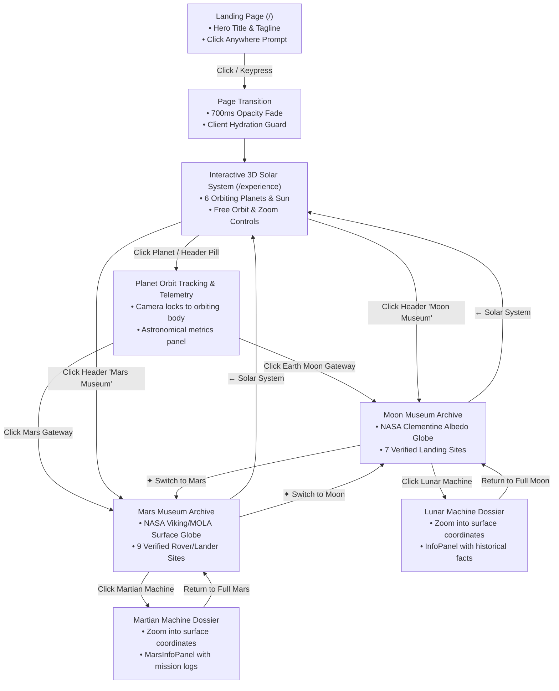
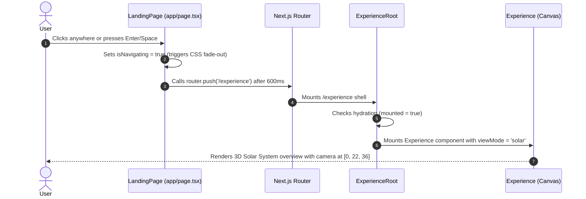
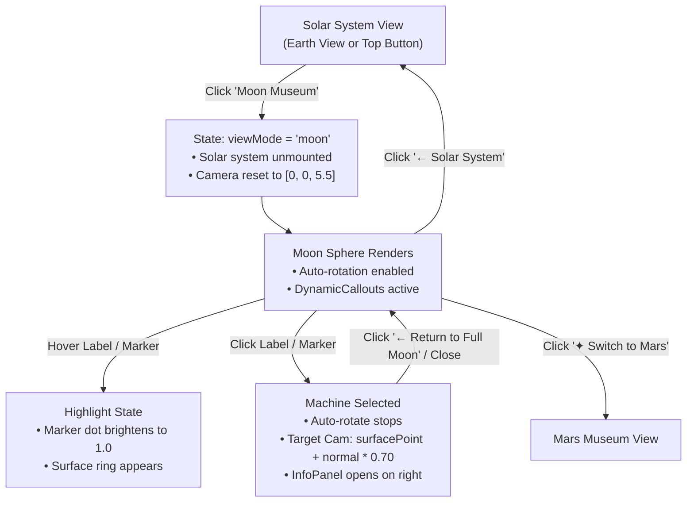
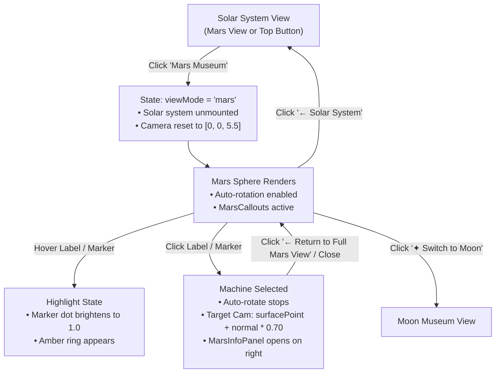

# 06 — Application Workflows

This document diagrams and explains the user journeys and navigational workflows implemented in **The Museum of Forgotten Machines**.

---

## 1. Master Application Flow Overview

The user journey transitions seamlessly from a cinematic entry point into multi-level celestial exploration:



---

## 2. Journey 1: Landing Page to Solar System



### Steps Explained
1. **User Activation:** The user clicks the landing page or presses `Enter`/`Space`.
2. **Smooth Fade:** `isNavigating` is set to `true`, animating the container opacity from `1` to `0` over 700ms.
3. **Route Navigation:** `router.push('/experience')` transitions to the experience route.
4. **Hydration Protection:** `ExperienceRoot` briefly shows `"Diving deep into space..."` while client-side WebGL initializes, avoiding SSR hydration errors.
5. **Initial 3D Scene:** The canvas loads with the Sun and 6 planets in motion, with orbit lines and overview UI.

---

## 3. Journey 2: Solar System to Planet Inspection

```mermaid
flowchart LR
    A["Solar Overview<br>Camera at [0, 22, 36]"] -->|Click Planet Mesh / Top Pill| B["Target Cam Calculation<br>livePos + offset * radius"]
    B -->|useFrame Lerp (0.05)| C["Dynamic Tracking Camera<br>Follows planet along orbit"]
    C --> D["PlanetInfoPanel Slides In<br>• Distance, Diameter, Periods<br>• Scientific Overview"]
    D -->|Click Close or Background| A
```

### Steps Explained
1. **Selection:** User clicks a planet in 3D space or clicks a planet pill in the top-right header (e.g., `Venus`, `Earth`, `Mars`, `Saturn`, `Uranus`, `Neptune`).
2. **Real-Time Orbit Following:** The `CameraController` calculates an offset position based on the planet's dynamic live coordinates and smoothly interpolates the camera and orbit target.
3. **Telemetry Panel:** `PlanetInfoPanel` renders scientific metrics derived from NASA orbital datasets.
4. **Dismissal:** Clicking `✕`, the `Reset View` button, or empty space smoothly returns the camera to the solar overview.

---

## 4. Journey 3: Entering & Exploring the Moon Museum



### Steps Explained
1. **Entry:** User clicks either the 3D Moon Gateway badge in Earth's orbit or the `✦ Moon Museum` button.
2. **Mode Switch:** `viewMode` changes to `'moon'`. Solar System assets unmount and the high-resolution 3D Moon sphere loads.
3. **Exploration:** The Moon slowly rotates. Hovering any straight white callout line or surface marker highlights the site.
4. **Machine Inspection:** Clicking a machine smoothly rotates and zooms the camera into close-up surface proximity ($0.70$ scene units from the surface) and opens the lunar historical dossier (`InfoPanel`).
5. **Return:** User can return to the full Moon view, return to the Solar System, or switch directly to Mars.

---

## 5. Journey 4: Entering & Exploring the Mars Museum



### Steps Explained
1. **Entry:** User clicks the 3D Mars Gateway badge in Mars's orbit or the `✦ Mars Museum` button.
2. **Mode Switch:** `viewMode` changes to `'mars'`. The 3D Mars sphere loads with authentic Viking/MOLA surface coloration.
3. **Surface Coordinates:** 9 historical landing sites display straight white connection lines to clean Space Grotesk labels.
4. **Rover Dossier:** Clicking a rover/lander (e.g., *Pathfinder*, *Curiosity*, *Perseverance*) zooms the camera into the landing crater and displays the mission logs (`MarsInfoPanel`).

---

## 6. Direct Cross-Museum Navigation
Visitors exploring the Moon can jump directly to Mars without returning to the Solar System overview using the contextual `✦ Switch to Mars` header button. Similarly, visitors on Mars can jump directly to the Moon via `✦ Switch to Moon`. All camera transitions interpolate smoothly without abrupt cuts.

---

*Related Documentation:*
- [03 — Project Architecture](file:///docs/03-project-architecture.md)
- [04 — Features and User Experience](file:///docs/04-features-and-user-experience.md)
- [07 — Visual Design and Interface](file:///docs/07-visual-design.md)
