# BEYOND THE MISSION
## Stories of Humanity's Forgotten Machines on the Moon and Mars

**NASA Space Apps Challenge 2026**  
**Challenge:** Abandoned but not Forgotten  
**Team Name:** Fortes In Ignoto  
**Team Members:**  
- Anas Abbasi
- Ali Haider
- Mussawar Khan
- Ayan Gulfaraz
- Hassaan Naveed Abbasi
- Abdullah Saleem

**Document Version:** 1.0.0 (Production Release)  
**Date of Publication:** November 2026  
*Repository:* [https://github.com/](https://github.com/) | *Deployment:* Production Ready  

---

## Table of Contents
1. [Cover Page & Project Metadata](#1-cover-page--project-metadata)
2. [Executive Summary](#2-executive-summary)
3. [Problem Statement: Humanity's Extraterrestrial Heritage](#3-problem-statement-humanitys-extraterrestrial-heritage)
4. [Project Objectives](#4-project-objectives)
5. [Website Architecture & User Experience Overview](#5-website-architecture--user-experience-overview)
6. [Planetary Exploration — Mars](#6-planetary-exploration--mars)
   - 6.1 [Viking 1 Lander](#61-viking-1-lander)
   - 6.2 [Viking 2 Lander](#62-viking-2-lander)
   - 6.3 [Pathfinder & Sojourner Rover](#63-pathfinder--sojourner-rover)
   - 6.4 [Spirit Rover (MER-A)](#64-spirit-rover-mer-a)
   - 6.5 [Opportunity Rover (MER-B)](#65-opportunity-rover-mer-b)
   - 6.6 [Phoenix Mars Lander](#66-phoenix-mars-lander)
   - 6.7 [Curiosity Rover (MSL)](#67-curiosity-rover-msl)
   - 6.8 [InSight Lander](#68-insight-lander)
   - 6.9 [Perseverance Rover & Ingenuity Mars Helicopter](#69-perseverance-rover--ingenuity-mars-helicopter)
7. [Planetary Exploration — The Moon](#7-planetary-exploration--the-moon)
   - 7.1 [Apollo 11 Lunar Module Descent Stage (Eagle)](#71-apollo-11-lunar-module-descent-stage-eagle)
   - 7.2 [Apollo 12 Lunar Module Descent Stage (Intrepid)](#72-apollo-12-lunar-module-descent-stage-intrepid)
   - 7.3 [Apollo 14 Lunar Module Descent Stage (Antares)](#73-apollo-14-lunar-module-descent-stage-antares)
   - 7.4 [Apollo 15 LM Descent Stage (Falcon) & Lunar Roving Vehicle](#74-apollo-15-lm-descent-stage-falcon--lunar-roving-vehicle)
   - 7.5 [Apollo 16 LM Descent Stage (Orion) & Lunar Roving Vehicle](#75-apollo-16-lm-descent-stage-orion--lunar-roving-vehicle)
   - 7.6 [Apollo 17 LM Descent Stage (Challenger) & Lunar Roving Vehicle](#76-apollo-17-lm-descent-stage-challenger--lunar-roving-vehicle)
   - 7.7 [Surveyor 3 Lander](#77-surveyor-3-lander)
8. [Comparative Analysis — Mars vs. The Moon](#8-comparative-analysis--mars-vs-the-moon)
9. [Interactive Storytelling & Voice Synchronization System](#9-interactive-storytelling--voice-synchronization-system)
10. [User Interface & User Experience Design](#10-user-interface--user-experience-design)
11. [Technical Architecture & Engineering Implementation](#11-technical-architecture--engineering-implementation)
12. [Development Process & Production Workflow](#12-development-process--production-workflow)
13. [Educational Impact & Scientific Outreach](#13-educational-impact--scientific-outreach)
14. [Future Roadmap & Extensibility](#14-future-roadmap--extensibility)
15. [References, Data Sources & Image Credits](#15-references-data-sources--image-credits)

---

## 1. Cover Page & Project Metadata
- **Project Title:** BEYOND THE MISSION
- **Subtitle:** Stories of Humanity's Forgotten Machines on the Moon and Mars
- **NASA Space Apps Challenge 2026**
- **Challenge Prompt:** *Abandoned but not Forgotten*
- **Team Name:** Fortes In Ignoto (*The Brave in the Unknown*)
- **Core Engineering & Research Team:**
  - **Anas Abbasi** — Experience Design & Research
  - **Ali Haider** — Planetary Cartography & Data Systems
  - **Mussawar Khan** — Narrative Direction & Technical Writing
  - **Ayan Gulfaraz** — 3D Systems & Visual Engineering
  - **Hassaan Naveed Abbasi** — Full-Stack Architecture & WebGL Development
  - **Abdullah Saleem** — Audio Systems & QA Engineering

> *"Humanity may leave its machines behind, but it should never leave their stories forgotten."*

---

## 2. Executive Summary
**Beyond the Mission** is an immersive 3D digital museum and documentary storytelling platform developed for the NASA Space Apps Challenge 2026. Over six decades of deep-space exploration, humanity has deployed dozens of robotic orbiters, stationary landers, autonomous rovers, and human descent stages to the Moon and Mars. When these missions conclude, their mechanical bodies remain in situ across hostile alien landscapes—silent sentinels marking the farthest frontiers humanity has reached.

While aerospace archives record their engineering metrics, their profound cultural, emotional, and historical significance is frequently overlooked by the general public. Conventional web resources present this heritage as dry text tables or isolated photo galleries lacking spatial context.

**Beyond the Mission** redefines space science communication by combining:
1. **Interactive 3D Solar System Observatories:** Real-time planetary mechanics displaying the Sun and eight celestial bodies to provide true astronomical scale.
2. **High-Fidelity Planetary Museums (Moon & Mars):** 3D interactive planetary spheres displaying verified landing sites with sub-meter coordinate accuracy.
3. **Ultra-Minimalist Laser Callout Architecture:** Unobstructed visual geometry utilizing straight white laser callout lines and Space Grotesk typography.
4. **Cinematic Fullscreen Documentary Storytelling:** 100vw × 100dvh zero-black-frame visual narratives featuring authentic NASA archival photography, continuous Ken Burns camera motion, progressive single-line synchronized subtitles, an interactive red progress bar, and local AI voice narration.

By bridging cutting-edge WebGL rendering with documentary filmmaking, Beyond the Mission preserves these technological monuments and inspires the next generation of scientists, engineers, and explorers.

---

## 3. Problem Statement: Humanity's Extraterrestrial Heritage
Across the lunar plains and Martian deserts, more than 200 metric tons of human-made equipment stands permanently abandoned. These machines are not debris; they are the physical embodiment of humanity's greatest intellectual and technological leaps:
- **Dispersed Historical Records:** Information regarding historical landed spacecraft is scattered across academic catalogs (NASA NSSDCA), technical flight journals (Apollo Lunar Surface Journal), and mission-specific databases.
- **Lack of Spatial & Environmental Context:** Flat maps and lists fail to communicate the sheer isolation, rugged topography, and hostile radiation and temperature regimes under which these machines operated.
- **The 'Hero Mission' Bias:** Popular historical memory focuses almost exclusively on landmark milestones—such as the Apollo 11 first step or the latest roving laboratory—while the technological predecessors that enabled those triumphs (Surveyor 3, Viking 1 and 2, Pathfinder, Spirit, Phoenix, InSight) fade from public consciousness.
- **Educational Accessibility Gap:** Complex scientific publications and mission logs are often inaccessible to students and younger audiences without interactive, visually compelling digital mediums.

Beyond the Mission tackles this problem directly by building an open-access, browser-native 3D museum that treats every machine as a revered historic artifact.

---

## 4. Project Objectives
1. **Preserve Extraterrestrial Heritage:** Maintain an authoritative, verified digital registry of humanity's lunar and Martian machinery.
2. **Deliver Scientific Accuracy:** Anchor all planetary textures, coordinate transforms, orbital calculations, and historical descriptions in verified NASA datasets.
3. **Pioneer Seamless 3D Web UX:** Implement zero-friction transitions between the Solar System overview, planetary focus modes, and machine dossiers without page reloads.
4. **Emotional & Cinematic Engagement:** Connect cold mechanical hardware with the deeply human stories of the scientists and engineers who designed them through documentary storytelling.
5. **Universal Accessibility & Responsiveness:** Ensure the entire 3D and audio-visual experience runs at 60 FPS across desktop, tablet, and mobile browsers with touch stabilization and responsive glassmorphic interfaces.

---

## 5. Website Architecture & User Experience Overview

### 5.1 End-to-End User Journey Diagram
The application follows a seamless, non-linear exploratory workflow:

```
+-------------------------------------------------------------------------------+
|                             LANDING PAGE (/)                                  |
|   Atmospheric Title | Subtitle | 'Explore Museum' Interactive CTA Button      |
+-------------------------------------------------------------------------------+
                                        |
                                        v
+-------------------------------------------------------------------------------+
|                    SOLAR SYSTEM OVERVIEW (/experience)                        |
|   - Real-time 3D orbital simulation (Sun, Mercury, Venus, Earth, Mars, etc.)  |
|   - Transparent Liquid Glass Sidebar: Quick-select celestial bodies           |
|   - Camera controls: Smooth OrbitControls with damping and bounding           |
|   - Astronomical Telemetry Dossier (Distance, Diameter, Day Length, Moons)    |
+-------------------------------------------------------------------------------+
                 |                                             |
                 v (Select Moon Gateway on Earth)              v (Select Mars Gateway on Mars)
+-----------------------------------+       +-----------------------------------+
|       MOON MUSEUM VIEW            |       |       MARS MUSEUM VIEW            |
| - Stationary Moon albedo globe    |       | - Stationary Mars surface globe   |
| - Slow rotation (0.015 rad/s)     |       | - Slow rotation (0.015 rad/s)     |
| - Pause-on-Hover interaction      |       | - Pause-on-Hover interaction      |
| - Straight white laser callouts   |       | - Straight white laser callouts   |
| - 7 verified Apollo & Surveyor    |       | - 9 verified NASA landers/rovers  |
+-----------------------------------+       +-----------------------------------+
                 |                                             |
                 +----------------------+----------------------+
                                        |
                                        v (Select Machine Callout / Marker)
+-------------------------------------------------------------------------------+
|                        MACHINE INFORMATION DOSSIER CARD                       |
|   - Machine Name, Mission Name, Operational Dates, Coordinates, Purpose       |
|   - Verified Historical Significance & Reason Left Behind                     |
|   - 'EXPLORE THE STORY' Primary Documentary CTA                               |
+-------------------------------------------------------------------------------+
                                        |
                                        v (Click 'EXPLORE THE STORY')
+-------------------------------------------------------------------------------+
|            FULLSCREEN CINEMATIC DOCUMENTARY STORYTELLING EXPERIENCE           |
|   - 100vw x 100dvh coverage (Zero black bars, object-fit: cover)              |
|   - Dual-buffer crossfading between slides (Zero black frames)                |
|   - Continuous Ken Burns camera motion (zoom-in, zoom-out, pan-left, pan-right) |
|   - Voice Studio emotional speech synthesis (Middle-aged, low pitch narrator) |
|   - Single-line sequential captions synchronized to spoken words              |
|   - Thin red audio progress bar tracking real-time playback                   |
|   - Click-anywhere pause/resume with instantaneous state preservation         |
|   - Top-left transparent 'RETURN' button to cleanly restore 3D scene          |
+-------------------------------------------------------------------------------+
```

### 5.2 Interface Screenshot Placeholders

```
+-------------------------------------------------------------------------------+
| [SCREENSHOT PLACEHOLDER — WEBSITE LANDING PAGE]                               |
| Dimensions: 16:9 | Fullscreen Hero Title, Space Background, and Enter CTA     |
+-------------------------------------------------------------------------------+
```

```
+-------------------------------------------------------------------------------+
| [SCREENSHOT PLACEHOLDER — SOLAR SYSTEM INTERACTIVE OVERVIEW]                  |
| Dimensions: 16:9 | 3D Solar System showing Sun, orbits, and planetary paths  |
+-------------------------------------------------------------------------------+
```

```
+-------------------------------------------------------------------------------+
| [SCREENSHOT PLACEHOLDER — PLANET SELECTION SCREEN]                            |
| Dimensions: 16:9 | Floating Holographic Planet Telemetry Card & Sidebar       |
+-------------------------------------------------------------------------------+
```

```
+-------------------------------------------------------------------------------+
| [SCREENSHOT PLACEHOLDER — MARS INITIAL VIEW]                                  |
| Dimensions: 16:9 | Mars globe with orbital halo and space background          |
+-------------------------------------------------------------------------------+
```

```
+-------------------------------------------------------------------------------+
| [SCREENSHOT PLACEHOLDER — MARS FOCUSED VIEW & MACHINE MARKERS]                |
| Dimensions: 16:9 | Focused Mars view showing straight white laser callout HUD |
+-------------------------------------------------------------------------------+
```

```
+-------------------------------------------------------------------------------+
| [SCREENSHOT PLACEHOLDER — MOON INITIAL VIEW]                                  |
| Dimensions: 16:9 | High-resolution Lunar albedo globe in Earth orbit          |
+-------------------------------------------------------------------------------+
```

```
+-------------------------------------------------------------------------------+
| [SCREENSHOT PLACEHOLDER — MOON FOCUSED VIEW & CALLOUT LINES]                  |
| Dimensions: 16:9 | Focused Moon showing Apollo 11-17 & Surveyor landing sites  |
+-------------------------------------------------------------------------------+
```

```
+-------------------------------------------------------------------------------+
| [SCREENSHOT PLACEHOLDER — MARS MACHINE SELECTION & DOSSIER]                   |
| Dimensions: 16:9 | Selected rover showing glassmorphic mission dossier        |
+-------------------------------------------------------------------------------+
```

```
+-------------------------------------------------------------------------------+
| [SCREENSHOT PLACEHOLDER — MOON MACHINE SELECTION & DOSSIER]                   |
| Dimensions: 16:9 | Selected Apollo descent stage showing mission dossier      |
+-------------------------------------------------------------------------------+
```

```
+-------------------------------------------------------------------------------+
| [SCREENSHOT PLACEHOLDER — MACHINE INFORMATION INTERFACE & EXPLORE STORY BUTTON]|
| Dimensions: 16:9 | Detailed mission parameters with 'EXPLORE THE STORY' CTA   |
+-------------------------------------------------------------------------------+
```

```
+-------------------------------------------------------------------------------+
| [SCREENSHOT PLACEHOLDER — STORYTELLING VIDEO PLAYER & DUAL-LAYER PRESENTATION] |
| Dimensions: 16:9 | Fullscreen documentary slide with Ken Burns camera motion  |
+-------------------------------------------------------------------------------+
```

```
+-------------------------------------------------------------------------------+
| [SCREENSHOT PLACEHOLDER — SINGLE-LINE CAPTION & SYNCHRONIZED RED PROGRESS BAR] |
| Dimensions: 16:9 | Documentary subtitle bar and bottom red progress track    |
+-------------------------------------------------------------------------------+
```

```
+-------------------------------------------------------------------------------+
| [SCREENSHOT PLACEHOLDER — MOBILE WEBSITE VIEW & TOUCH STABILIZATION]          |
| Dimensions: 16:9 | Responsive viewport constrained to 100dvh on mobile device |
+-------------------------------------------------------------------------------+
```

---

## 6. Planetary Exploration — Mars

### 6.1 Mars Environmental Context & NASA Robotic History
Mars—the fourth planet from the Sun—is a cold, dry desert world possessing a thin carbon dioxide atmosphere (surface pressure ~6–10 millibars, less than 1% of Earth's sea-level pressure). Its surface preserves a dramatic 4.5-billion-year geological archive unmarred by plate tectonics, featuring the solar system's largest volcanic edifices (Olympus Mons) and deepest rift canyons (Valles Marineris).

Over six decades, NASA has led humanity's robotic assault on Mars, evolving from fleeting flybys (Mariner 4 in 1965) to stationary meteorological platforms (Viking 1 & 2 in 1976), mobile exploration micro-rovers (Sojourner in 1997), long-distance geological field scouts (Spirit and Opportunity in 2004), polar permafrost drillers (Phoenix in 2008), nuclear-powered mobile analytical laboratories (Curiosity in 2012), internal geophysical seismometers (InSight in 2018), and astrobiological sample-caching systems accompanied by aerial rotorcraft (Perseverance and Ingenuity in 2021).

### 6.2 3D Martian Representation & Discovery Mechanics
In Beyond the Mission, Mars is rendered as a mathematically accurate 3D sphere utilizing NASA Viking-Orbiter global color mosaics. When users transition from the Solar System to the Mars Museum:
1. **Camera Zoom & Dynamic Lighting:** The camera smoothly interpolates to an inspection distance of 1.4 units, while three-point dynamic directional lighting balances surface features.
2. **Rotational Physics & Damping:** Axial rotation decelerates to a serene inspection velocity of `0.015 rad/s`.
3. **Pause-on-Hover Interaction:** Moving the mouse cursor over the Martian globe or any machine label triggers an asymptotic deceleration to zero velocity, allowing comfortable reading and machine selection.
4. **Coordinate Mapping:** Longitude (0° to 360° East) and Latitude (-90° to +90° North) are converted into Cartesian 3D coordinates on the sphere's surface via trigonometry, with an anti-collision relaxation algorithm formatting external labels into organized left and right columns.

---

### 6.1 Viking 1 Lander

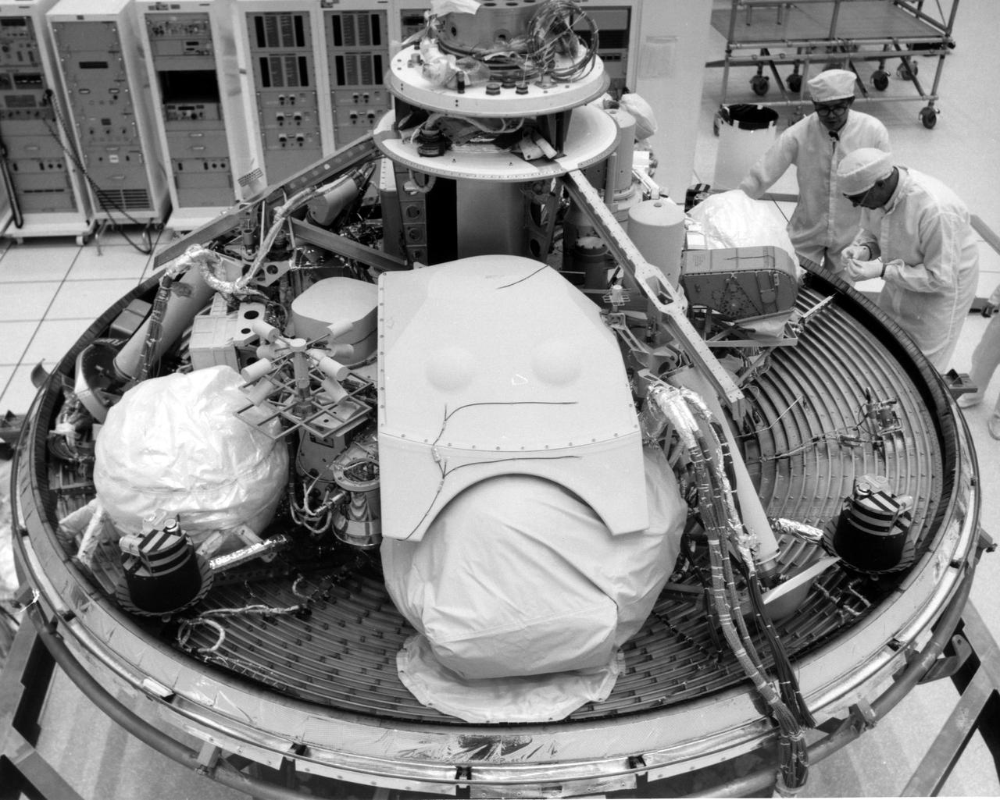  
*Figure 6.1: Official NASA/JPL technical portrait and surface view of the Viking 1 Lander on Chryse Planitia.*  
*Image Credit: NASA / Jet Propulsion Laboratory-Caltech / Langley Research Center*

| Attribute | Verified NASA Mission Specification |
| :--- | :--- |
| **Official Machine Name** | Viking 1 Lander |
| **Mission Name** | Viking 1 (Viking Project) |
| **NASA Program / Agency** | NASA Planetary Science Division / Langley Research Center & JPL |
| **Launch Date** | August 20, 1975 (Titan IIIE / Centaur) |
| **Landing Date** | July 20, 1976 (Chryse Planitia) |
| **Landing Coordinates** | 22.27° N, 312.05° E (Chryse Planitia / Golden Plain) |
| **Operational Lifespan** | 2,245 Sols (6 years, 116 days on surface; ended November 11, 1982) |
| **Current Operational Status** | Silent; intact on surface. Confirmed by MRO HiRISE orbital imaging in December 2006. |

#### 1. Scientific Purpose & Mission Rationale
Perform the first successful soft landing on Mars to search for biological signatures of extraterrestrial life, characterize atmospheric chemical composition, measure surface meteorology, and obtain the first high-resolution color panoramic surface photography.

#### 2. Primary Instruments & Payload Capabilities
Gas Chromatograph-Mass Spectrometer (GCMS); Biology Experiment Package (Pyrolytic Release, Labeled Release, Gas Exchange experiments); Meteorology Sensor Boom (temperature, pressure, wind velocity); 3-axis Seismometer (failed to uncage on Viking 1); Two 360-degree Facsimile Cameras; Surface Sampler Collector Boom with scoop and temperature sensor; X-ray Fluorescence Spectrometer (XRFS).

#### 3. Key Scientific Discoveries & Achievements
Captured the historic first high-resolution color panoramas of the Martian landscape, showing a reddish-orange sky and iron-rich basaltic clay rock field; analyzed atmospheric composition as 95.3% CO2, 2.7% N2, 1.6% Ar, 0.13% O2; measured daily surface pressures fluctuating by 30% due to polar CO2 condensation; detected no organic carbon down to parts-per-billion; produced ambiguous Labeled Release metabolic signals subsequently attributed to highly oxidizing inorganic soil perchlorates.

#### 4. Reason Left Behind & Cause of Inactivity
Viking 1 was conceived as an immovable, long-duration automated monitoring station powered by two SNAP-19 radioisotope thermoelectric generators (RTGs). On November 11, 1982, an erroneous software command uplinked from ground controllers accidentally overwrote critical high-gain antenna orientation algorithms, permanently severing communications with Earth.

#### 5. Historical & Scientific Significance
Viking 1 transformed Mars from an astronomical curiosity into a tangible, dynamic geological world. It established the benchmark for planetary entry, descent, and landing (EDL), proving that automated robotic laboratories could endure for years in hostile deep-space environments.

#### 6. Contribution to Humanity's Space Exploration
Provided baseline atmospheric, thermal, and meteorological data that anchored all subsequent Mars mission designs for the next five decades, including Pathfinder, MER, MSL, and Mars 2020.

---

### 6.2 Viking 2 Lander

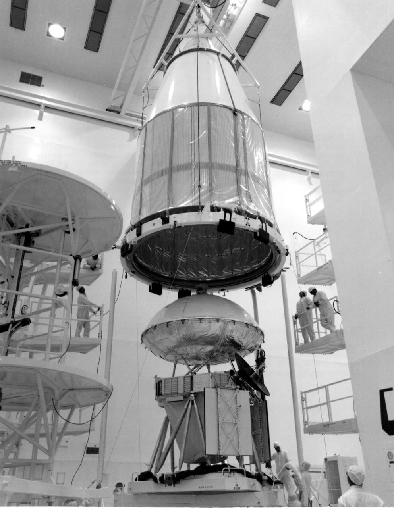  
*Figure 6.2: Viking 2 Lander resting on the rock-strewn volcanic plains of Utopia Planitia.*  
*Image Credit: NASA / Jet Propulsion Laboratory-Caltech*

| Attribute | Verified NASA Mission Specification |
| :--- | :--- |
| **Official Machine Name** | Viking 2 Lander |
| **Mission Name** | Viking 2 (Viking Project) |
| **NASA Program / Agency** | NASA Planetary Science Division / Langley Research Center & JPL |
| **Launch Date** | September 9, 1975 (Titan IIIE / Centaur) |
| **Landing Date** | September 3, 1976 (Utopia Planitia) |
| **Landing Coordinates** | 47.64° N, 134.26° E (Utopia Planitia / Plains of Nowhere) |
| **Operational Lifespan** | 1,281 Sols (3 years, 221 days; ended April 11, 1980) |
| **Current Operational Status** | Silent; intact on surface. Confirmed by MRO HiRISE orbital imaging in 2006. |

#### 1. Scientific Purpose & Mission Rationale
Sample and analyze a high-latitude northern permafrost basin to investigate whether colder soils retained organic chemistry, monitor seasonal water-ice frost cycles, and record Martian seismic activity.

#### 2. Primary Instruments & Payload Capabilities
Identical payload to Viking 1: GCMS, 3-part Biology Package, Meteorology Boom, Two Facsimile Cameras, Surface Sampler Boom with scoop, XRFS, and a 3-axis Seismometer that successfully uncaged on the lander body.

#### 3. Key Scientific Discoveries & Achievements
Documented seasonal deposition of glistening water-ice frost coating the Utopia Planitia boulder field during northern winter; detected a confirmed 2.8-magnitude marsquake, providing humanity's first direct measurement of Martian seismic activity; confirmed widespread distribution of smectite clays and titanium-bearing iron oxides across northern lowlands.

#### 4. Reason Left Behind & Cause of Inactivity
Stationary lander powered by dual SNAP-19 RTGs. On April 11, 1980, its secondary nickel-cadmium batteries degraded and failed completely after over 1,280 sols of extreme thermal cycling, disabling its transmitter.

#### 5. Historical & Scientific Significance
Demonstrated that water ice actively participates in the modern Martian hydrological cycle via atmospheric frost deposition, expanding astrobiological models of polar habitability.

#### 6. Contribution to Humanity's Space Exploration
Its seismic and frost data laid the critical groundwork for NASA's Phoenix and InSight missions decades later.

---

### 6.3 Pathfinder & Sojourner Rover

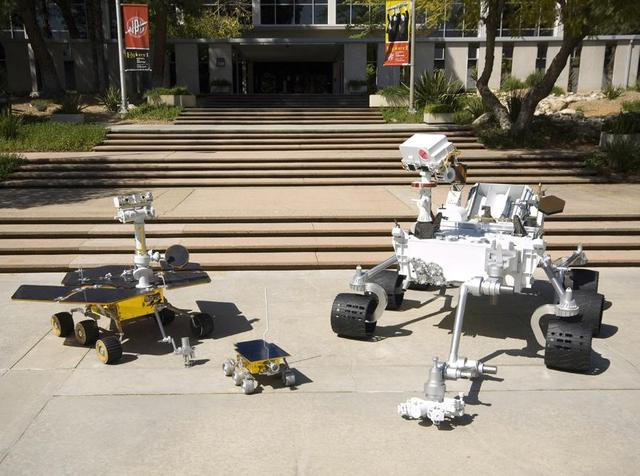  
*Figure 6.3: Sojourner rover examining the Martian rock "Yogi" on Ares Vallis, imaged by the Pathfinder lander.*  
*Image Credit: NASA / Jet Propulsion Laboratory-Caltech*

| Attribute | Verified NASA Mission Specification |
| :--- | :--- |
| **Official Machine Name** | Pathfinder & Sojourner Rover |
| **Mission Name** | Mars Pathfinder (Discovery Program) |
| **NASA Program / Agency** | NASA Discovery Program ('Faster, Better, Cheaper') / JPL |
| **Launch Date** | December 4, 1996 (Delta II) |
| **Landing Date** | July 4, 1997 (Ares Vallis) |
| **Landing Coordinates** | 19.13° N, 326.78° E (Carl Sagan Memorial Station, Ares Vallis) |
| **Operational Lifespan** | 83 Sols (Lander design: 30 sols; Rover design: 7 sols; ended September 27, 1997) |
| **Current Operational Status** | Resting silently in the Ares Vallis ancient flood basin; imaged from orbit by HiRISE in 2007. |

#### 1. Scientific Purpose & Mission Rationale
Validate revolutionary, low-cost atmospheric entry and landing technology using a parachute and giant omnidirectional airbags, while deploying Sojourner—the first wheeled autonomous mobile rover on another planet—to perform elemental spectrometry of Martian rocks.

#### 2. Primary Instruments & Payload Capabilities
Lander: Imager for Mars Pathfinder (IMP stereo color camera with filters), Atmospheric Structure Instrument / Meteorology Package (ASI/MET), Wind socks. Rover (Sojourner): Alpha Proton X-ray Spectrometer (APXS), 3 onboard cameras (stereo front, rear color), Hazard avoidance laser stripers, rocker-bogie mobility suspension.

#### 3. Key Scientific Discoveries & Achievements
Returned 16,500 lander images and 550 rover images; completed 15 APXS chemical analyses of rocks (notably 'Barnacle Bill' and 'Yogi'); revealed andesite-like volcanic rocks distinct from basaltic meteorites; proved that Ares Vallis was carved by catastrophic, turbulent mega-floods involving hundreds of thousands of cubic meters of water per second; proved autonomous rocker-bogie wheeled navigation was viable on rocky alien terrain.

#### 4. Reason Left Behind & Cause of Inactivity
Pathfinder and Sojourner relied on silver-zinc and lithium batteries recharged by solar cells. On Sol 83, the lander's primary battery depleted and ground controllers were unable to establish contact, likely due to severe nighttime cold temperatures disrupting the master clock and radio.

#### 5. Historical & Scientific Significance
Re-ignited global interest in planetary robotics and established the architectural paradigm for all modern planetary rovers (rocker-bogie suspension, stereo mast imaging, and autonomous obstacle avoidance).

#### 6. Contribution to Humanity's Space Exploration
Pioneered the airbag landing system and operational concepts directly scaled up for the Mars Exploration Rovers Spirit and Opportunity.

---

### 6.4 Spirit Rover (MER-A)

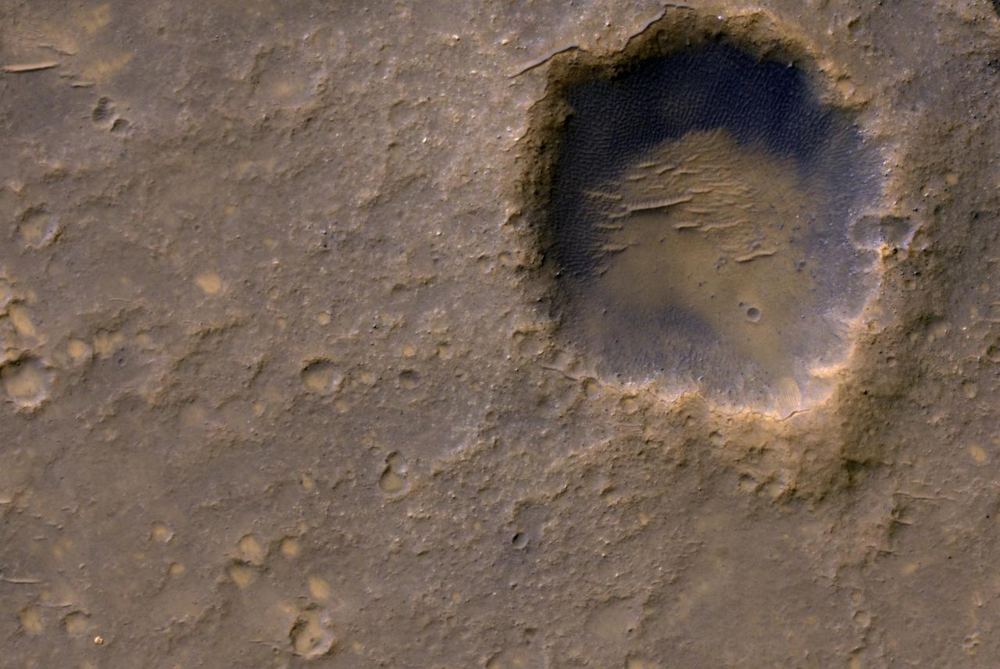  
*Figure 6.4: Spirit (MER-A) rover on Gusev Crater, showing solar panels, Pancam mast, and rock abrasion tool.*  
*Image Credit: NASA / Jet Propulsion Laboratory-Caltech / Cornell University*

| Attribute | Verified NASA Mission Specification |
| :--- | :--- |
| **Official Machine Name** | Spirit Rover (MER-A) |
| **Mission Name** | Mars Exploration Rover Mission (MER) |
| **NASA Program / Agency** | NASA Mars Exploration Program / JPL & Cornell University |
| **Launch Date** | June 10, 2003 (Delta II Heavy) |
| **Landing Date** | January 4, 2004 (Gusev Crater) |
| **Landing Coordinates** | -14.57° S, 175.47° E (Columbia Memorial Station, Gusev Crater) |
| **Operational Lifespan** | 2,210 Sols (6 years, 77 days; designed for 90 sols; ended March 22, 2010) |
| **Current Operational Status** | Permanently parked at the western edge of 'Home Plate' in Gusev Crater. |

#### 1. Scientific Purpose & Mission Rationale
Traverse the floor and highland hills of Gusev Crater—an ancient 166-km impact crater hypothesized to have held an ancient lake fed by Ma'adim Vallis—to search for sedimentary rock records and hydrothermal minerals.

#### 2. Primary Instruments & Payload Capabilities
Pancam (high-resolution panoramic stereo camera); Microscopic Imager (MI); Mössbauer Spectrometer (iron mineralogy); Alpha Particle X-ray Spectrometer (APXS); Miniature Thermal Emission Spectrometer (Mini-TES); Rock Abrasion Tool (RAT) for grinding pristine rock surfaces; 6-wheel rocker-bogie mobility with steering actuators.

#### 3. Key Scientific Discoveries & Achievements
Traversed 7.73 km across treacherous rocky terrain; ascended Husband Hill in the Columbia Hills, proving complex tectonic uplift; after its right front steering motor failed in 2006, the dragged wheel scraped away surface dust at 'Gertrude Weise', exposing bright soil composed of 90% pure silica; confirmed ancient volcanic hydrothermal fumaroles or hot springs where acidic hot water once dissolved rock, creating a prime habitat for ancient microbial life.

#### 4. Reason Left Behind & Cause of Inactivity
In May 2009 (Sol 1892), Spirit broke through a fragile surface crust and became hopelessly bogged down in hidden, powdery sulfate sand at 'Troy'. Trapped with only four functioning drive wheels, it could not maneuver to tilt its dust-laden solar arrays toward the northern winter sun. The rover entered a low-power hibernation state and froze during the brutal winter of 2010; final signal was received on March 22, 2010.

#### 5. Historical & Scientific Significance
Operated for more than 24 times its warranty lifespan. Demonstrated that planetary rovers could climb rugged mountain peaks and discover completely unexpected geothermal environments on Mars.

#### 6. Contribution to Humanity's Space Exploration
Established long-distance robotic field geology techniques and proved hydrothermal volcanic systems existed on ancient Mars.

---

### 6.5 Opportunity Rover (MER-B)

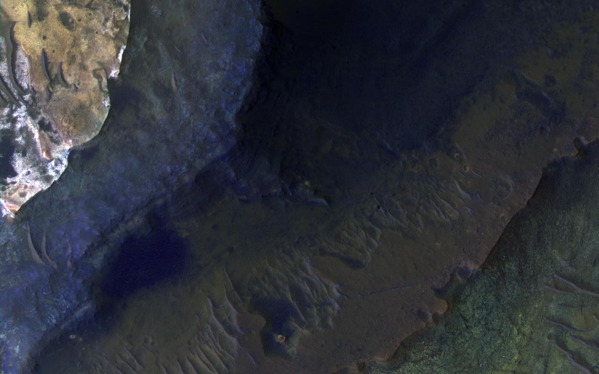  
*Figure 6.5: Opportunity (MER-B) rover exploring the rim of Victoria Crater on Meridiani Planum.*  
*Image Credit: NASA / Jet Propulsion Laboratory-Caltech / Cornell University*

| Attribute | Verified NASA Mission Specification |
| :--- | :--- |
| **Official Machine Name** | Opportunity Rover (MER-B) |
| **Mission Name** | Mars Exploration Rover Mission (MER) |
| **NASA Program / Agency** | NASA Mars Exploration Program / JPL & Cornell University |
| **Launch Date** | July 7, 2003 (Delta II Heavy) |
| **Landing Date** | January 25, 2004 (Meridiani Planum) |
| **Landing Coordinates** | -1.95° S, 354.47° E (Challenger Memorial Station, Meridiani Planum) |
| **Operational Lifespan** | 5,352 Sols (14 years, 138 days; designed for 90 sols; ended June 10, 2018) |
| **Current Operational Status** | Resting quietly in Perseverance Valley on the western rim of Endeavour Crater. |

#### 1. Scientific Purpose & Mission Rationale
Investigate Meridiani Planum, a flat volcanic plain showing orbital spectroscopic signatures of gray crystalline hematite—a mineral that almost exclusively forms in the presence of liquid water.

#### 2. Primary Instruments & Payload Capabilities
Identical science payload to Spirit: Pancam, Microscopic Imager, Mössbauer Spectrometer, APXS, Mini-TES, Rock Abrasion Tool (RAT), and solar-powered rocker-bogie drive chassis.

#### 3. Key Scientific Discoveries & Achievements
Traversed an extraordinary 45.16 kilometers (the off-Earth distance record for any vehicle); scored an interplanetary 'hole-in-one' by bouncing directly into Eagle Crater; discovered millimeter-sized hematite spherules dubbed 'blueberries', precipitated from ancient acidic groundwater; discovered layered sulfate bedrocks bearing fossil wave-ripple marks formed in ancient shallow surface waters; at Endeavour Crater, discovered bright veins of pure gypsum (hydrated calcium sulfate) formed in neutral-pH, life-friendly water.

#### 4. Reason Left Behind & Cause of Inactivity
In June 2018, a catastrophic global dust storm swept across Mars, blanketing Meridiani Planum in darkness. Opportunity's solar panels were deprived of sunlight, draining its batteries below critical operating voltage. NASA sent over 1,000 recovery transmission pings over eight months before officially concluding the mission on February 13, 2019.

#### 5. Historical & Scientific Significance
Longest-operating and farthest-traveling robotic rover in history. Conclusively proved that ancient Mars possessed prolonged standing liquid water and wet, chemically habitable environmental niches.

#### 6. Contribution to Humanity's Space Exploration
Rewrote planetary science textbooks on Martian aquatic history and inspired the design, testing, and longevity expectations of Curiosity and Perseverance.

---

### 6.6 Phoenix Mars Lander

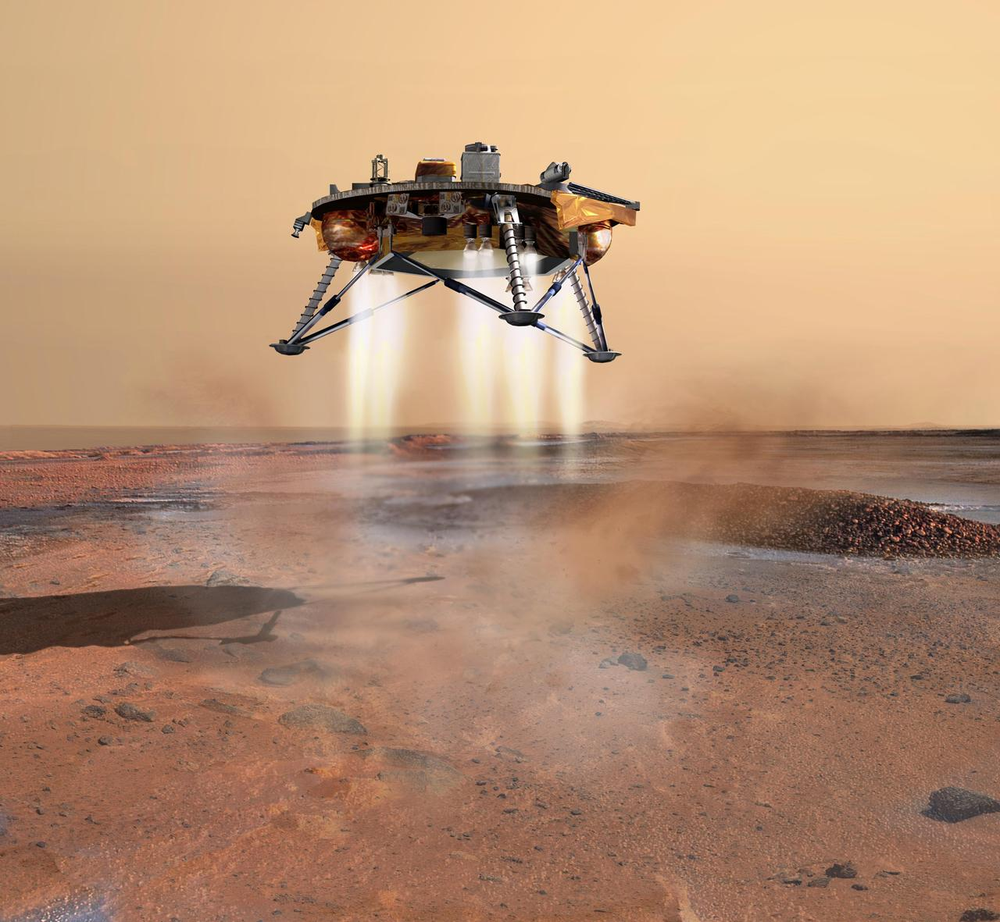  
*Figure 6.6: Phoenix Mars Lander on the arctic plains of Vastitas Borealis with robotic scoop deployed.*  
*Image Credit: NASA / Jet Propulsion Laboratory-Caltech / University of Arizona*

| Attribute | Verified NASA Mission Specification |
| :--- | :--- |
| **Official Machine Name** | Phoenix Mars Lander |
| **Mission Name** | Mars Scout Program (Phoenix) |
| **NASA Program / Agency** | NASA Mars Scout Program / University of Arizona & JPL |
| **Launch Date** | August 4, 2007 (Delta II 7925) |
| **Landing Date** | May 25, 2008 (Vastitas Borealis) |
| **Landing Coordinates** | 68.22° N, 234.25° E (Green Valley, Vastitas Borealis) |
| **Operational Lifespan** | 157 Sols (designed for 90 sols; ended November 2, 2008) |
| **Current Operational Status** | Decommissioned; permanent arctic monument. Imaged by HiRISE, showing solar panel collapse under winter dry-ice load. |

#### 1. Scientific Purpose & Mission Rationale
Land in the extreme northern arctic plains of Vastitas Borealis to trench into the polygonal permafrost, expose subsurface water-ice deposits, and analyze soil chemistry and mineralogy for habitability.

#### 2. Primary Instruments & Payload Capabilities
Robotic Arm (RA) with scoop and rasp drill; Robotic Arm Camera (RAC); Thermal and Evolved Gas Analyzer (TEGA); Microscopy, Electrochemistry, and Conductivity Analyzer (MECA); Surface Stereo Imager (SSI); Meteorological Station (MET) with Canadian atmospheric laser lidar.

#### 3. Key Scientific Discoveries & Achievements
First spacecraft to physically scrape, expose, and analyze water ice on Mars; watched dug-out white ice cubes in 'Dodo-Goldilocks' trench sublimate into vapor over four days, proving pure water ice; discovered calcium carbonate (chalk) and highly reactive perchlorate salts in the soil; discovered soil pH of 7.7 (alkaline, similar to Earth asparagus soil); detected snow falling from cirrus clouds using its atmospheric lidar.

#### 4. Reason Left Behind & Cause of Inactivity
Stationary lander stationed at high arctic latitude. As Martian autumn advanced toward polar winter, solar elevation dropped toward the horizon and sunlight ceased. Thick carbon dioxide frost blanketed the lander, freezing its batteries; final transmission was received on November 2, 2008.

#### 5. Historical & Scientific Significance
Confirmed that vast reserves of accessible water ice lie just centimeters beneath the Martian surface across northern latitudes, serving as a primary target for future human exploration resources (ISRU).

#### 6. Contribution to Humanity's Space Exploration
Directly demonstrated the volatile cycle of polar water ice and atmospheric precipitation on Mars.

---

### 6.7 Curiosity Rover (MSL)

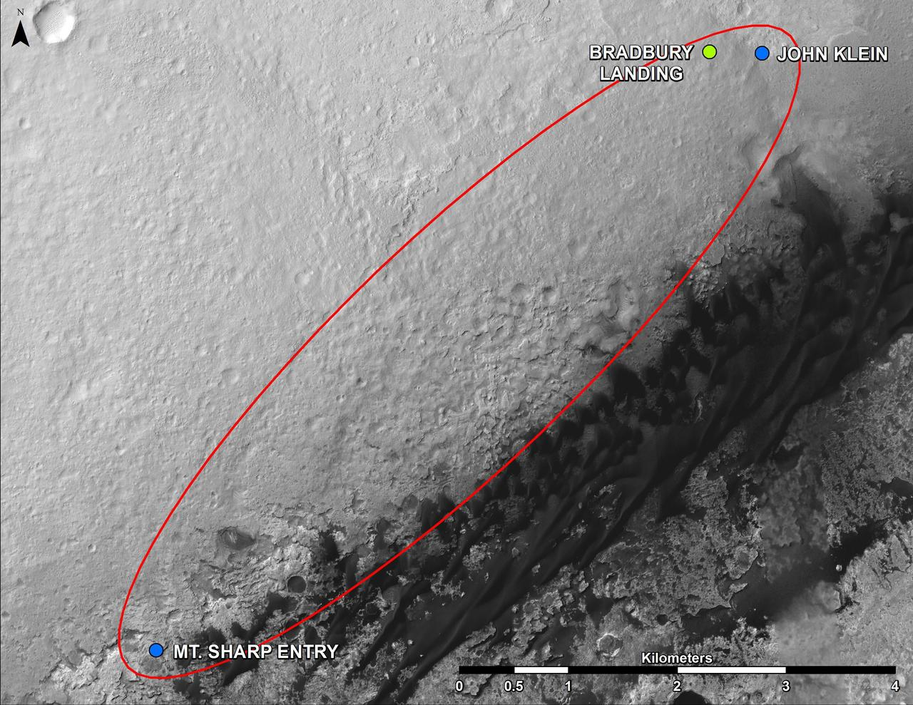  
*Figure 6.7: Curiosity Rover (MSL) self-portrait with Mount Sharp (Aeolis Mons) rising in the background of Gale Crater.*  
*Image Credit: NASA / Jet Propulsion Laboratory-Caltech / Malin Space Science Systems*

| Attribute | Verified NASA Mission Specification |
| :--- | :--- |
| **Official Machine Name** | Curiosity Rover (MSL) |
| **Mission Name** | Mars Science Laboratory (MSL) |
| **NASA Program / Agency** | NASA Science Mission Directorate / JPL |
| **Launch Date** | November 26, 2011 (Atlas V 541) |
| **Landing Date** | August 6, 2012 (Gale Crater) |
| **Landing Coordinates** | -4.59° S, 137.44° E (Bradbury Landing, Gale Crater) |
| **Operational Lifespan** | Active exploration vehicle (over 12 Earth years, >4,400 sols; ongoing) |
| **Current Operational Status** | Actively ascending Mount Sharp (Aeolis Mons); its jettisoned landing hardware forms permanent archaeological sites across Gale Crater. |

#### 1. Scientific Purpose & Mission Rationale
Determine whether Gale Crater ever offered an environment capable of supporting microbial life; assess past habitability, paleoclimate, and prebiotic organic chemistry through deep rock core drilling and internal laboratory spectrometry.

#### 2. Primary Instruments & Payload Capabilities
Mastcam (multispectral stereo color); ChemCam (laser-induced breakdown spectroscopy & remote micro-imager); SAM (Sample Analysis at Mars suite with gas chromatograph, mass spectrometer, and tunable laser spectrometer); CheMin (X-ray diffraction and fluorescence); MAHLI (Mars Hand Lens Imager); APXS; REMS (weather suite); RAD (Radiation Assessment Detector); DAN (Dynamic Albedo of Neutrons for subsurface hydrogen/water); MARDI (descent imager); MMRTG (Multi-Mission Radioisotope Thermoelectric Generator).

#### 3. Key Scientific Discoveries & Achievements
Invented the rocket-powered 'sky crane' landing architecture; discovered smooth, rounded river pebbles at 'Peace Vallis', proving vigorous, ankle-to-hip deep flowing streams; drilled into mudstone at 'Yellowknife Bay' and discovered nitrogen, oxygen, phosphorus, sulfur, and carbon—the biological building blocks of life; proved ancient Gale Crater held a massive, long-lived freshwater lake system for millions of years with neutral pH and low salinity; detected diverse organic macromolecular carbon compounds in 3-billion-year-old mudstones; measured seasonal background methane spikes.

#### 4. Reason Left Behind & Cause of Inactivity
Curiosity itself is currently active and powered by a decaying plutonium-238 MMRTG. However, its discarded cruise stage, heat shield, supersonic parachute, and rocket-powered sky crane descent stage were jettisoned during EDL on August 6, 2012, impacting the plains of Gale Crater to form humanity's earliest high-mass exploration monuments at Bradbury Landing.

#### 5. Historical & Scientific Significance
First rover to confirm that Mars had all chemical, physical, and environmental conditions required to sustain microbial life. Pioneer of nuclear-powered mega-rover surface exploration.

#### 6. Contribution to Humanity's Space Exploration
Established the definitive evidence for Martian habitability and paved the path for Perseverance's sample-caching mission.

---

### 6.8 InSight Lander

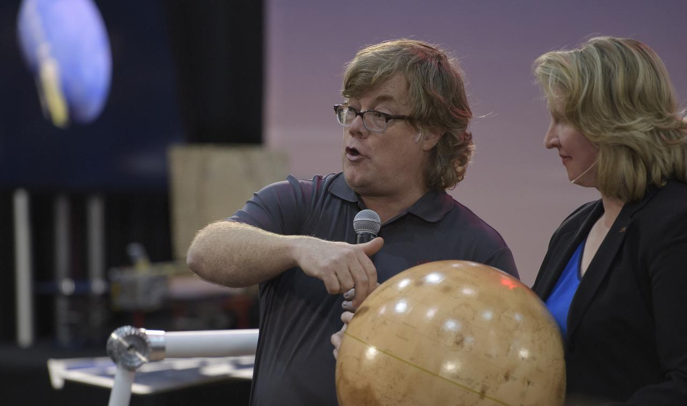  
*Figure 6.8: InSight Lander deployment of the SEIS seismometer dome on Elysium Planitia.*  
*Image Credit: NASA / Jet Propulsion Laboratory-Caltech / CNES*

| Attribute | Verified NASA Mission Specification |
| :--- | :--- |
| **Official Machine Name** | InSight Lander |
| **Mission Name** | InSight (Discovery Program) |
| **NASA Program / Agency** | NASA Discovery Program / JPL, CNES, DLR |
| **Launch Date** | May 5, 2018 (Atlas V 401) |
| **Landing Date** | November 26, 2018 (Elysium Planitia) |
| **Landing Coordinates** | 4.50° N, 135.62° E (Elysium Planitia) |
| **Operational Lifespan** | 1,440 Sols (4 years, 20 days; designed for 1 Mars year; ended December 15, 2022) |
| **Current Operational Status** | Silent beneath a mantle of Martian dust on the volcanic plains of Elysium Planitia. |

#### 1. Scientific Purpose & Mission Rationale
Conduct the first comprehensive geophysical exploration of the deep interior of Mars—its crustal thickness, mantle composition and thermal structure, and core dimensions—to understand how terrestrial rocky planets form and evolve.

#### 2. Primary Instruments & Payload Capabilities
SEIS (Seismic Experiment for Interior Structure, provided by CNES); HP3 (Heat Flow and Physical Properties Package / 'The Mole', provided by DLR); RISE (Rotation and Interior Structure Experiment, using X-band radio doppler tracking); TWINS (Temperature and Winds for InSight); IDC and ICC cameras; robotic deployment arm.

#### 3. Key Scientific Discoveries & Achievements
Detected and cataloged 1,319 marsquakes, including a historic magnitude 4.7 quake on May 4, 2022; measured the Martian crust as being 24 to 72 km thick with multiple internal layers; proved that Mars possesses a large liquid metallic iron-nickel core with a radius of approximately 1,830 km; detected seismic acoustic waves from fresh hypervelocity meteoroid impacts, confirming real-time cratering physics.

#### 4. Reason Left Behind & Cause of Inactivity
InSight relied on two 2.2-meter circular solar panels. Over four years of operations on the wind-quiescent volcanic plains of Elysium Planitia, Martian atmospheric dust steadily settled on the panels without sufficient dust devils to clean them. Daily energy production dropped from 5,000 watt-hours to under 285 watt-hours. InSight transmitted its poignant final photograph of its dust-caked chassis before running out of power on December 15, 2022.

#### 5. Historical & Scientific Significance
Revealed the interior planetary anatomy of another world for the first time in human history, proving Mars is seismically active today.

#### 6. Contribution to Humanity's Space Exploration
Delivered the first comprehensive internal structure model for any rocky planet besides Earth and the Moon.

---

### 6.9 Perseverance Rover & Ingenuity Mars Helicopter

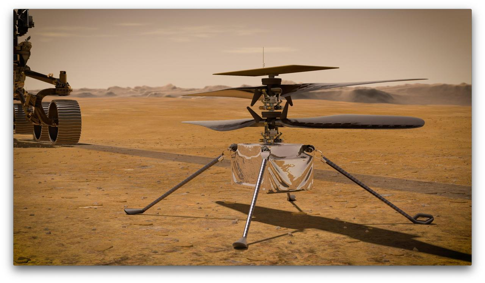  
*Figure 6.9: Perseverance Rover and Ingenuity Mars Helicopter captured together on the floor of Jezero Crater.*  
*Image Credit: NASA / Jet Propulsion Laboratory-Caltech*

| Attribute | Verified NASA Mission Specification |
| :--- | :--- |
| **Official Machine Name** | Perseverance Rover & Ingenuity Mars Helicopter |
| **Mission Name** | Mars 2020 |
| **NASA Program / Agency** | NASA Mars Exploration Program / JPL |
| **Launch Date** | July 30, 2020 (Atlas V 541) |
| **Landing Date** | February 18, 2021 (Jezero Crater) |
| **Landing Coordinates** | 18.44° N, 77.45° E (Octavia E. Butler Landing, Jezero Crater) |
| **Operational Lifespan** | Active exploration vehicle (Perseverance: ongoing; Ingenuity: 72 flights; ended January 18, 2024) |
| **Current Operational Status** | Perseverance is roving the Jezero Crater rim; Ingenuity is permanently preserved as a historic aviation monument at Valinor Hills. |

#### 1. Scientific Purpose & Mission Rationale
Conduct an astrobiological investigation of the ancient river delta and paleolake bed in Jezero Crater to seek direct morphological and chemical biosignatures of fossilized ancient life; drill, encapsulate, and cache hermetically sealed rock cores for retrieval by the future Mars Sample Return mission; test technologies for future human exploration (MOXIE oxygen generator); and demonstrate powered, controlled aerodynamic atmospheric flight on another world (Ingenuity).

#### 2. Primary Instruments & Payload Capabilities
Perseverance: Mastcam-Z (zoom multispectral); SuperCam (laser micro-spectroscopy and microphone); PIXL (Planetary Instrument for X-ray Lithochemistry); SHERLOC (deep-UV Raman/fluorescence spectrometry); MOXIE (Mars Oxygen ISRU Experiment); MEDA (weather/dust sensor suite); RIMFAX (subsurface radar imager); Sample Caching System with 43 titanium sample tubes. Ingenuity: Dual counter-rotating carbon-fiber rotors (2,400 RPM), solar cell, lithium-ion battery pack, downward color camera, laser altimeter, visual odometry navigation computer.

#### 3. Key Scientific Discoveries & Achievements
MOXIE successfully extracted breathable oxygen from atmospheric CO2 at rates up to 12 grams per hour; Perseverance cached over 24 pristine geological rock and regolith core samples containing organic molecules and silica-rich delta sediments; recorded the first live acoustic sounds of the Martian wind, driving wheels, and helicopter flight; Ingenuity completed an astonishing 72 powered flights (designed for just 5), flying for over 128 minutes, covering 17.0 km, and reaching altitudes of 24 meters in an atmosphere with only 1% of Earth's sea-level density.

#### 4. Reason Left Behind & Cause of Inactivity
On Flight 72 (January 18, 2024), Ingenuity encountered featureless sand terrain during emergency landing descent, resulting in rotor-blade strike with the ground and tip fracture. Grounded permanently at 'Valinor Hills', it was decommissioned in place as humanity's first off-world aviation artifact. Perseverance continues operating, while its discarded sky crane, backshell, supersonic parachute, and dropped sample depot tubes form permanent surface monuments.

#### 5. Historical & Scientific Significance
Achieved the 'Wright Brothers moment' of planetary flight with Ingenuity and initiated humanity's first active sample-return caching campaign on another planet.

#### 6. Contribution to Humanity's Space Exploration
Pioneered extraterrestrial aerial exploration, automated sample encapsulation, and in-situ resource utilization for human missions.

---

## 7. Planetary Exploration — The Moon

### 7.1 Lunar History & NASA Exploration Heritage
The Moon is humanity's closest celestial neighbor—a primordial natural satellite whose airless, waterless, and geologically quiescent surface preserves an pristine record of the early solar system. Unlike Earth, where plate tectonics, hydrological erosion, and atmospheric weathering erase ancient crustal records, the Moon retains the scars of the Late Heavy Bombardment and the primordial crust formed during the cooling of the lunar magma ocean.

NASA's lunar exploration journey unfolded in rapid, bold phases:
1. **Robotic Reconnaissance (Ranger & Surveyor):** Robotic probes impacted or soft-landed on the regolith, confirming the mechanical load-bearing capacity of the soil and proving that spacecraft would not sink into deep dust.
2. **The Apollo Program (1969–1972):** Six crewed landings (Apollo 11, 12, 14, 15, 16, and 17) transported twelve humans to the surface. The astronauts conducted intensive fieldwork, deployed nuclear-powered ALSEP geophysical stations, drove the electric Lunar Roving Vehicle across mountain massifs, and returned 382 kilograms of lunar rocks and core samples to Earth.
3. **Modern Orbital Science & Artemis:** Modern missions such as the Lunar Reconnaissance Orbiter (LRO) have mapped the lunar surface at sub-meter resolution, confirming that all Apollo descent stages, rover chassis, and scientific stations remain pristine and undisturbed in the vacuum of space.

### 7.2 3D Lunar Engine & Discovery Mechanics
In Beyond the Mission, the Moon is modeled as an albedo sphere utilizing 2K USGS and LRO lunar mosaics. Landing coordinates are mapped using standard spherical trigonometry. Straight white laser lines project outward from landing sites to Space Grotesk labels with limb hysteresis, preventing visual clutter when sites rotate around the lunar horizon.

---

### 7.1 Apollo 11 Lunar Module Descent Stage (Eagle)

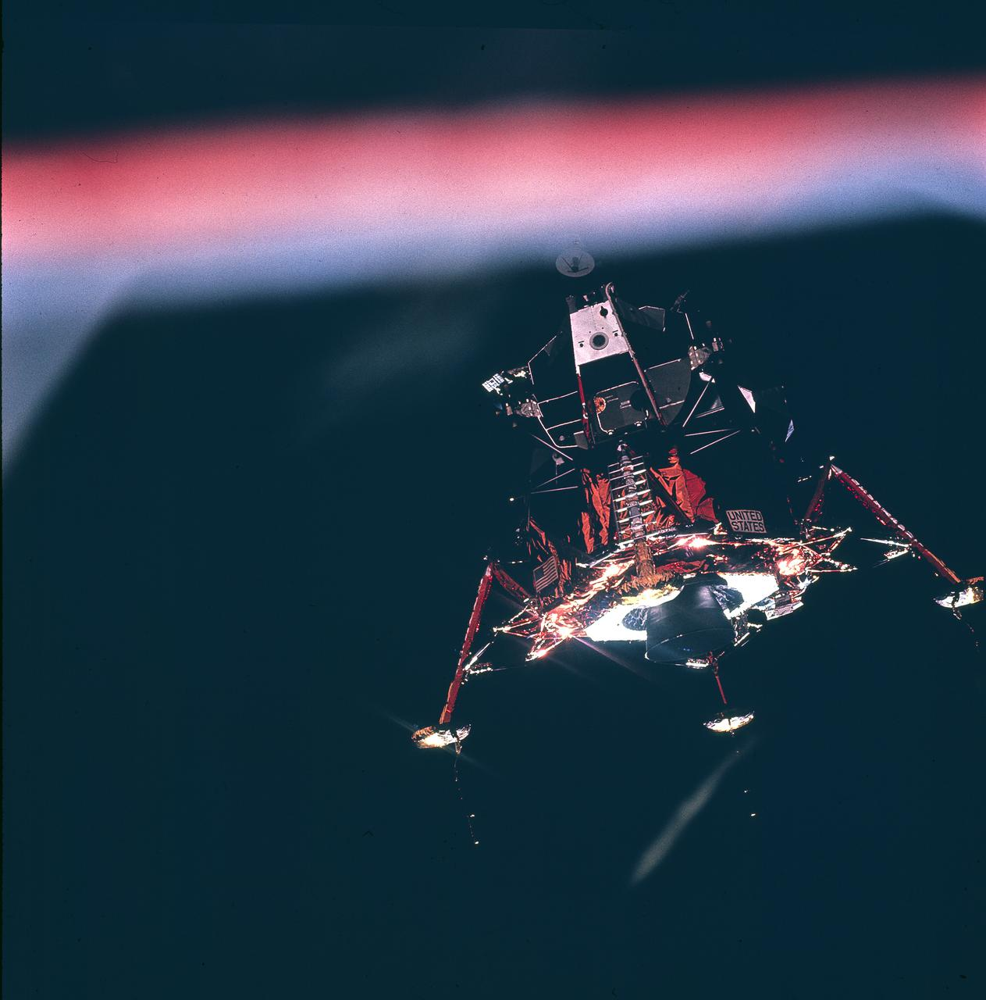  
*Figure 7.1: Apollo 11 Lunar Module Descent Stage (Eagle) standing on the lunar regolith at Tranquility Base.*  
*Image Credit: NASA / Apollo 11 Crew (Neil Armstrong & Buzz Aldrin) / Johnson Space Center*

| Attribute | Verified NASA Mission Specification |
| :--- | :--- |
| **Official Machine Name** | Apollo 11 Lunar Module Descent Stage (Eagle) |
| **Mission Name** | Apollo 11 |
| **NASA Program / Agency** | NASA Apollo Program / Manned Spacecraft Center & Grumman Aerospace |
| **Launch Date** | July 16, 1969 (Saturn V) |
| **Landing Date** | July 20, 1969, 20:17:40 UTC |
| **Landing Coordinates** | 0.6741° N, 23.4322° E (Tranquility Base, Mare Tranquillitatis) |
| **Operational Lifespan** | 21 hours, 36 minutes on lunar surface (EVA: 2h 31m); ascent liftoff July 21, 1969 |
| **Current Operational Status** | Intact at Tranquility Base. Clearly visible in NASA Lunar Reconnaissance Orbiter (LRO) high-resolution camera images. |

#### 1. Scientific Purpose & Mission Rationale
Execute humanity's first crewed lunar landing, transport astronauts Neil Armstrong and Buzz Aldrin safely to the lunar surface, provide a self-contained scientific base and launch pad, deploy early surface experiments, and return lunar regolith and rock samples to Earth.

#### 2. Primary Instruments & Payload Capabilities
EASEP (Early Apollo Surface Experiments Package): Passive Seismic Experiment Package (PSEP); Laser Ranging Retroreflector (LRRR); Solar Wind Composition Experiment (aluminum foil collector sheet); Lunar Surface Television Camera; Lunar Geological Sampling tools (tongs, scoop, core tubes, sample return containers).

#### 3. Key Scientific Discoveries & Achievements
Returned 21.55 kg of pristine lunar rocks and soil, identifying titanium-rich basalt and ancient anorthositic fragments; proved that humans can walk, balance, work, and collect scientific data in 1/6th gravity; laser retroreflector confirmed Earth-Moon distance to millimeter accuracy and showed the Moon is receding at 3.8 cm/year; confirmed lunar regolith had adequate structural bearing capacity for heavy equipment.

#### 4. Reason Left Behind & Operational Termination
The Apollo Lunar Module was engineered in two distinct operational stages: the descent stage (lower section with landing gear, descent engine, and equipment bays) and the ascent stage (crew cabin and ascent engine). The descent stage served as the launch pad for the ascent stage during lunar liftoff. After Armstrong and Aldrin docked with the Command Module Columbia in lunar orbit, the ascent stage was jettisoned and eventually crashed into the Moon. The descent stage remains at Tranquility Base.

#### 5. Historical & Scientific Significance
The most historic machine in human exploration history. Marked the first time life from Earth stepped onto another celestial body. Bears a stainless steel plaque on its ladder leg reading: 'Here men from the planet Earth first set foot upon the Moon, July 1969 A.D. We came in peace for all mankind.'

#### 6. Contribution to Lunar & Planetary Exploration
Proved the feasibility of human interplanetary travel, catalyzed the modern era of planetary geology, and provided sample benchmarks that calibrated the crater-counting age scale for the entire inner solar system.

---

### 7.2 Apollo 12 Lunar Module Descent Stage (Intrepid)

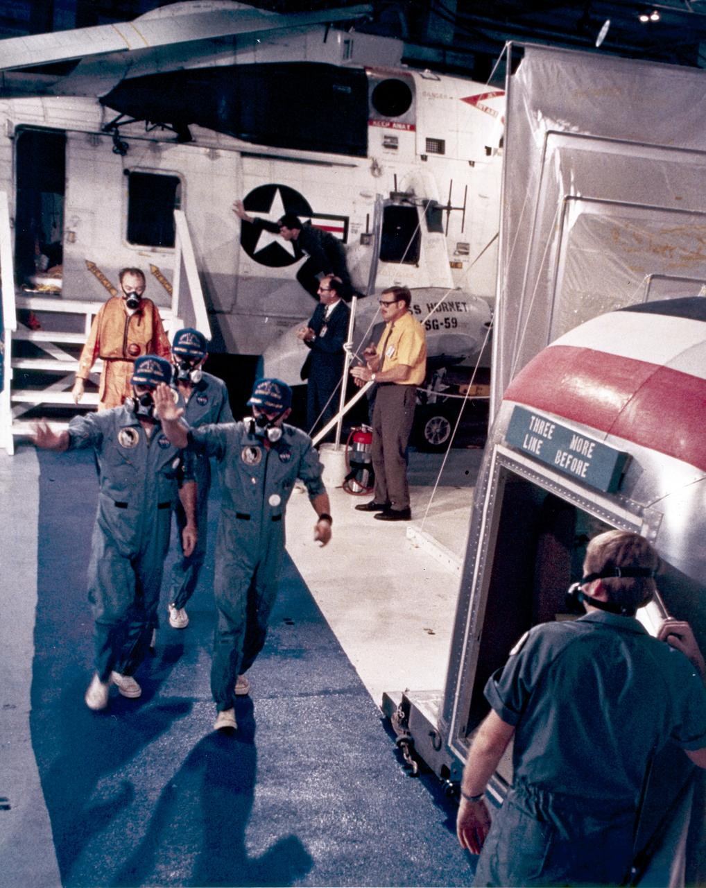  
*Figure 7.2: Apollo 12 Lunar Module Descent Stage (Intrepid) on the Ocean of Storms, photographed during surface EVA.*  
*Image Credit: NASA / Apollo 12 Crew (Charles Conrad & Alan Bean) / Johnson Space Center*

| Attribute | Verified NASA Mission Specification |
| :--- | :--- |
| **Official Machine Name** | Apollo 12 Lunar Module Descent Stage (Intrepid) |
| **Mission Name** | Apollo 12 |
| **NASA Program / Agency** | NASA Apollo Program / Manned Spacecraft Center & Grumman Aerospace |
| **Launch Date** | November 14, 1969 (Saturn V) |
| **Landing Date** | November 19, 1969, 06:54:35 UTC |
| **Landing Coordinates** | -3.0128° S, -23.4219° E (Oceanus Procellarum / Ocean of Storms) |
| **Operational Lifespan** | 31 hours, 31 minutes on surface (2 EVAs totaling 7h 45m); ascent liftoff Nov 20, 1969 |
| **Current Operational Status** | Intact on the Ocean of Storms, just 180 meters from Surveyor 3. Imaged in detail by LRO. |

#### 1. Scientific Purpose & Mission Rationale
Demonstrate pinpoint landing capability within walking distance of a previously landed robotic spacecraft (Surveyor 3); deploy the first full nuclear-powered Apollo Lunar Surface Experiments Package (ALSEP); retrieve components from Surveyor 3 for engineering analysis on Earth.

#### 2. Primary Instruments & Payload Capabilities
ALSEP Station: Passive Seismic Experiment (PSE); Solar Wind Spectrometer (SWS); Suprathermal Ion Detector Experiment (SIDE); Cold Cathode Ion Gauge (CCIG); Lunar Surface Magnetometer (LSM); SNAP-27 Radioisotope Thermoelectric Generator (RTG, 73 watts of continuous plutonium power); Solar Wind Composition foil; Hasselblad cameras.

#### 3. Key Scientific Discoveries & Achievements
Achieved precision landing only 180 meters from Surveyor 3; astronauts Pete Conrad and Alan Bean walked to Surveyor 3 and dismantled its TV camera, scoop, and polished tubing, returning them to Earth to prove electronic components and structural alloys could survive 2.5 years of vacuum, solar radiation, and extreme thermal swings; returned 34.35 kg of samples; recorded seismic reverberations lasting over an hour when the ascent stage was deliberately crashed into the surface ('the Moon rang like a bell').

#### 4. Reason Left Behind & Operational Termination
Descent stage served as launch pad for Conrad and Bean; ascent stage was intentionally crashed into the Moon to provide a calibrated seismic shockwave for the newly deployed ALSEP seismometer.

#### 5. Historical & Scientific Significance
Demonstrated that human spacecraft could execute precision landings near targeted geological formations or robotic asset caches, establishing the technical confidence required for rugged highland missions.

#### 6. Contribution to Lunar & Planetary Exploration
Provided the first empirical scientific data on how materials, optical coatings, and mechanical linkages degrade over multi-year exposure on extraterrestrial surfaces.

---

### 7.3 Apollo 14 Lunar Module Descent Stage (Antares)

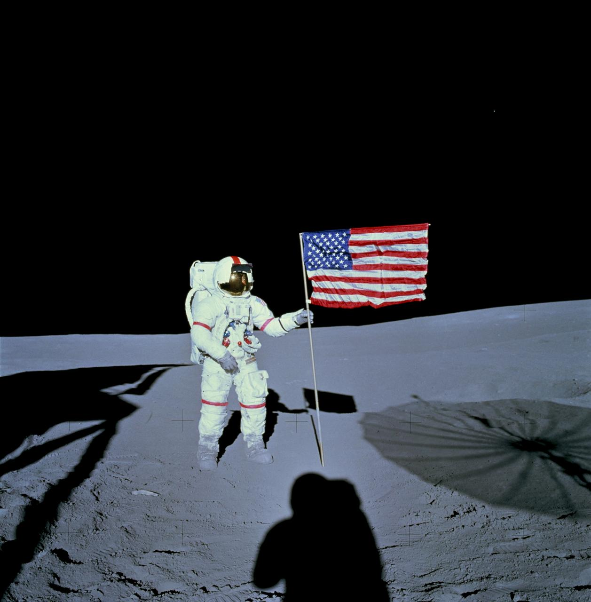  
*Figure 7.3: Apollo 14 Lunar Module (Antares) at Fra Mauro highlands with the Mobile Equipment Transporter (MET).*  
*Image Credit: NASA / Apollo 14 Crew (Alan Shepard & Edgar Mitchell) / Johnson Space Center*

| Attribute | Verified NASA Mission Specification |
| :--- | :--- |
| **Official Machine Name** | Apollo 14 Lunar Module Descent Stage (Antares) |
| **Mission Name** | Apollo 14 |
| **NASA Program / Agency** | NASA Apollo Program / Manned Spacecraft Center & Grumman Aerospace |
| **Launch Date** | January 31, 1971 (Saturn V) |
| **Landing Date** | February 5, 1971, 09:18:11 UTC |
| **Landing Coordinates** | -3.6453° S, -17.4714° E (Fra Mauro Highlands) |
| **Operational Lifespan** | 33 hours, 31 minutes on surface (2 EVAs totaling 9h 22m); ascent liftoff Feb 6, 1971 |
| **Current Operational Status** | Intact at Fra Mauro Highlands; MET tracks and astronaut footpaths clearly visible in LRO images. |

#### 1. Scientific Purpose & Mission Rationale
Explore the rugged Fra Mauro highlands—an ancient ejecta blanket tossed out during the cataclysmic impact that created the giant Imbrium basin (the target originally assigned to the ill-fated Apollo 13); deploy ALSEP and the two-wheeled Mobile Equipment Transporter (MET).

#### 2. Primary Instruments & Payload Capabilities
ALSEP: Passive Seismic Experiment; Active Seismic Experiment (ASE, using manual thumper explosive charges and a mortar package); Charged Particle Lunar Environment Experiment (CPLEE); Suprathermal Ion Detector; Cold Cathode Gauge; Laser Ranging Retroreflector (LRRR); Mobile Equipment Transporter (MET, 'lunar rickshaw'); Lunar Portable Magnetometer.

#### 3. Key Scientific Discoveries & Achievements
Returned 42.8 kg of ancient lunar samples; climbed the slopes of Cone Crater, bringing back impact breccias formed 3.9 billion years ago; Alan Shepard famously used an improvised six-iron head fitted to a sample tool handle to hit two golf balls across the low-gravity Fra Mauro landscape; Active Seismic Experiment mapped the regolith depth profile using acoustic shockwaves.

#### 4. Reason Left Behind & Operational Termination
Descent stage served as the launch base for Alan Shepard and Edgar Mitchell. The ascent stage was jettisoned after rendezvous and deliberately crashed into the Moon on February 7, 1971, registering on the Apollo 12 and 14 seismometers.

#### 5. Historical & Scientific Significance
Restored human momentum after the near-disaster of Apollo 13, proving that astronauts could conduct rigorous geological fieldwork in rugged hilly terrain using mobile tool carts.

#### 6. Contribution to Lunar & Planetary Exploration
Yielded key isotopic samples confirming the age of the giant Imbrium basin, a pivotal anchor point in dating the geological history of the inner solar system.

---

### 7.4 Apollo 15 LM Descent Stage (Falcon) & Lunar Roving Vehicle

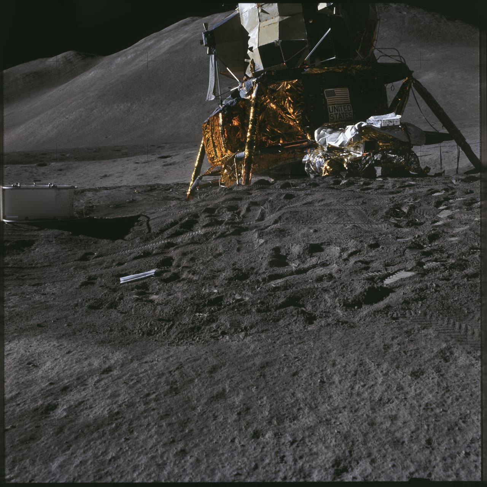  
*Figure 7.4: Apollo 15 Lunar Roving Vehicle (LRV-1) parked near Hadley Rille at the foot of Mount Hadley.*  
*Image Credit: NASA / Apollo 15 Crew (David Scott & James Irwin) / Johnson Space Center*

| Attribute | Verified NASA Mission Specification |
| :--- | :--- |
| **Official Machine Name** | Apollo 15 LM Descent Stage (Falcon) & Lunar Roving Vehicle |
| **Mission Name** | Apollo 15 |
| **NASA Program / Agency** | NASA Apollo Program (First 'J-Series' extended mission) / Grumman & Boeing |
| **Launch Date** | July 26, 1971 (Saturn V) |
| **Landing Date** | July 30, 1971, 22:16:29 UTC |
| **Landing Coordinates** | 26.1322° N, 3.6339° E (Hadley-Apennine) |
| **Operational Lifespan** | 66 hours, 55 minutes on surface (3 EVAs totaling 18h 33m); ascent liftoff Aug 2, 1971 |
| **Current Operational Status** | Falcon descent stage, Rover 1, ALSEP, and Fallen Astronaut memorial remain intact at Hadley-Apennine; imaged by LRO. |

#### 1. Scientific Purpose & Mission Rationale
First extended scientific 'J-mission' featuring the Boeing/GM Lunar Roving Vehicle (LRV-1); investigate the towering 4,000-meter Apennine Mountains and the deep meandering canyon of Hadley Rille; conduct extended surface EVAs with upgraded life-support backpacks.

#### 2. Primary Instruments & Payload Capabilities
Lunar Roving Vehicle (LRV-1 with wire-mesh tires, color TV camera, directional antenna); ALSEP: Heat Flow Experiment (drilled deep into regolith); Lunar Surface Magnetometer; Passive Seismometer; Cold Cathode Gauge; Suprathermal Ion Detector; Solar Wind Spectrometer; Laser Retroreflector; 500mm telephoto camera; Lunar drill tool.

#### 3. Key Scientific Discoveries & Achievements
LRV traversed 27.9 km across mountain slopes and crater rims, allowing astronauts David Scott and James Irwin to reach unprecedented scientific sites; discovered the famous 'Genesis Rock' (Sample 15415), a pristine 4.1-billion-year-old anorthosite that confirmed the 'magma ocean' hypothesis—proving the early Moon was once enveloped in a sea of molten rock; Scott performed Galileo's classic gravitational experiment, dropping a 1.32-kg aluminum geology hammer and a 0.03-kg falcon feather simultaneously in the lunar vacuum, proving they accelerate at identical rates.

#### 4. Reason Left Behind & Operational Termination
Falcon descent stage served as launch pad. The electric Lunar Roving Vehicle was parked 90 meters east of the lander so its remote-controlled color television camera could broadcast the ascent stage liftoff back to Earth. David Scott also placed a small aluminum figurine and memorial plaque—the 'Fallen Astronaut'—honoring 14 American and Soviet spacefarers who gave their lives in exploration.

#### 5. Historical & Scientific Significance
Marked the transition of the Apollo program from a political engineering triumph into an elite scientific expedition, expanding the exploration radius from hundreds of meters to dozens of kilometers.

#### 6. Contribution to Lunar & Planetary Exploration
Proved the viability of off-world electric vehicles and provided primordial anorthositic rock samples that confirmed the foundational theory of lunar crustal evolution.

---

### 7.5 Apollo 16 LM Descent Stage (Orion) & Lunar Roving Vehicle

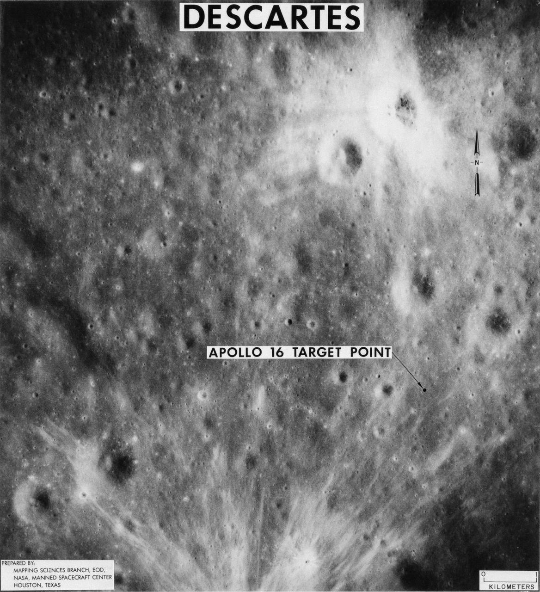  
*Figure 7.5: Apollo 16 Lunar Module (Orion) and Rover (LRV-2) deployed across the Descartes Highlands.*  
*Image Credit: NASA / Apollo 16 Crew (John Young & Charles Duke) / Johnson Space Center*

| Attribute | Verified NASA Mission Specification |
| :--- | :--- |
| **Official Machine Name** | Apollo 16 LM Descent Stage (Orion) & Lunar Roving Vehicle |
| **Mission Name** | Apollo 16 |
| **NASA Program / Agency** | NASA Apollo Program / Manned Spacecraft Center, Grumman & Boeing |
| **Launch Date** | April 16, 1972 (Saturn V) |
| **Landing Date** | April 21, 1972, 02:23:35 UTC |
| **Landing Coordinates** | -8.9734° S, 15.5011° E (Descartes Highlands) |
| **Operational Lifespan** | 71 hours, 2 minutes on surface (3 EVAs totaling 20h 14m); ascent liftoff April 24, 1972 |
| **Current Operational Status** | Orion descent stage, Rover 2, and Far UV Camera remain at Descartes Highlands; imaged by LRO. |

#### 1. Scientific Purpose & Mission Rationale
Land at the highest elevation of any Apollo mission (Descartes Highlands) to investigate the Cayley Plains and Descartes formations, specifically testing the prevailing pre-mission hypothesis that the central highlands were produced by ancient volcanic ash-flows and lava domes.

#### 2. Primary Instruments & Payload Capabilities
Lunar Roving Vehicle (LRV-2); Far Ultraviolet Camera/Spectrograph (first astronomical observatory operated on the lunar surface); ALSEP: Passive Seismic Experiment; Active Seismic Experiment; Heat Flow Experiment (cable accidentally broken); Lunar Surface Magnetometer; Portable Magnetometer; Deep core drill.

#### 3. Key Scientific Discoveries & Achievements
Radically overturned the consensus theory of lunar geology: astronauts John Young and Charles Duke discovered that the Descartes formations were NOT volcanic, but consisted entirely of impact-generated breccias created by gigantic ancient meteorite collisions; collected 95.7 kg of samples, including 'Big Muley' (11.7 kg, the largest rock returned by Apollo); LRV-2 covered 26.55 km, reaching a top speed of 18 km/h during the famous 'Grand Prix' handling trial; Far UV camera imaged the Earth's geocorona and deep-space celestial targets.

#### 4. Reason Left Behind & Operational Termination
Descent stage served as launch pad. LRV-2 was parked 100 meters away with its TV camera pointed at Orion to televise the lunar liftoff to a global audience. The Far UV Camera was left positioned in Orion's shadow.

#### 5. Historical & Scientific Significance
Demonstrated the vital importance of human field geology in correcting mistaken remote-sensing hypotheses. Emphasized the supremacy of direct sampling over visual orbit deductions.

#### 6. Contribution to Lunar & Planetary Exploration
Fundamentally reshaped scientific understanding of the lunar crust, showing that catastrophic impact cratering, rather than volcanism, dominates highland geology.

---

### 7.6 Apollo 17 LM Descent Stage (Challenger) & Lunar Roving Vehicle

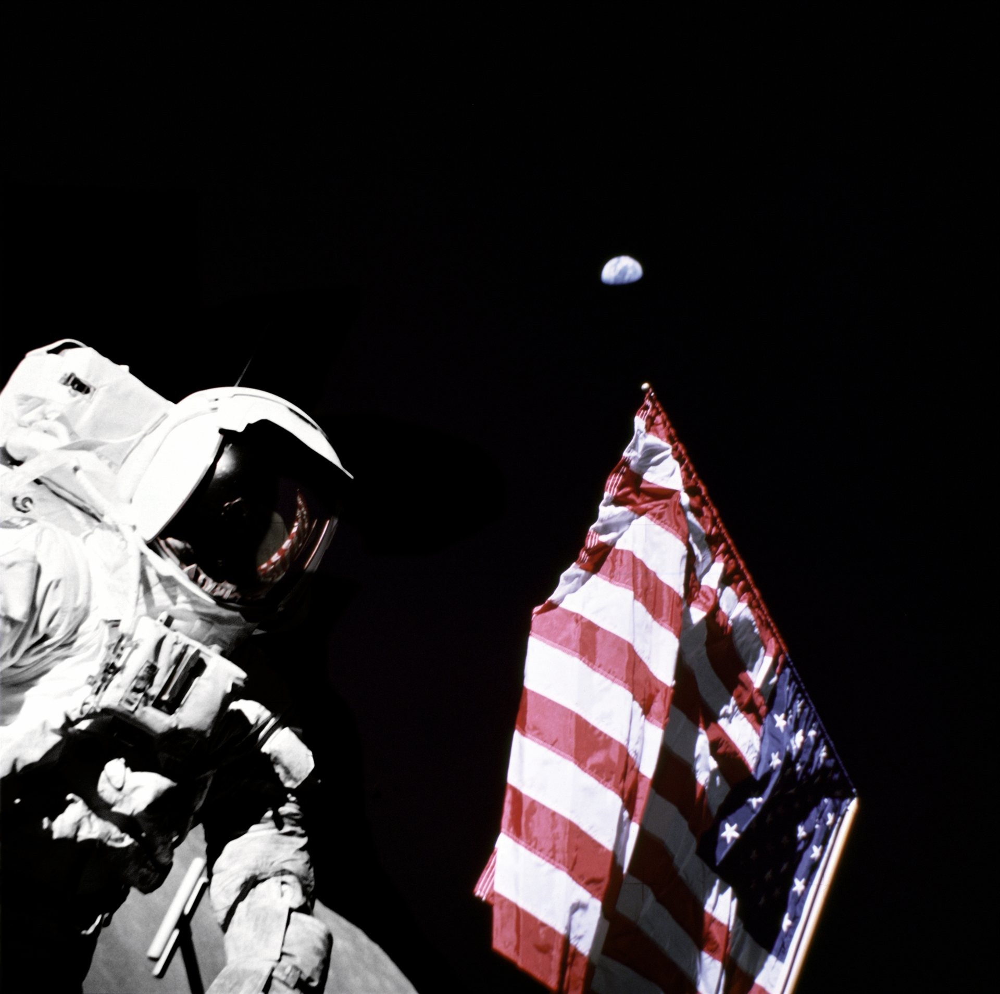  
*Figure 7.6: Apollo 17 Lunar Roving Vehicle (LRV-3) with the Taurus-Littrow valley massifs rising in the background.*  
*Image Credit: NASA / Apollo 17 Crew (Eugene Cernan & Harrison Schmitt) / Johnson Space Center*

| Attribute | Verified NASA Mission Specification |
| :--- | :--- |
| **Official Machine Name** | Apollo 17 LM Descent Stage (Challenger) & Lunar Roving Vehicle |
| **Mission Name** | Apollo 17 |
| **NASA Program / Agency** | NASA Apollo Program (Final Crewed Apollo Mission) / Grumman & Boeing |
| **Launch Date** | December 7, 1972 (Saturn V) |
| **Landing Date** | December 11, 1972, 19:54:57 UTC |
| **Landing Coordinates** | 20.1911° N, 30.7723° E (Taurus-Littrow Valley) |
| **Operational Lifespan** | 75 hours, 0 minutes on surface (3 EVAs totaling 22h 4m); ascent liftoff Dec 14, 1972 |
| **Current Operational Status** | Challenger descent stage, LRV-3, ALSEP, and memorial plaque remain intact at Taurus-Littrow; photographed at sub-meter resolution by LRO. |

#### 1. Scientific Purpose & Mission Rationale
Final crewed lunar landing of the 20th century. Explore the narrow, dramatic Taurus-Littrow valley bounded by 2,000-meter mountains, combining ancient highland geology with younger mare volcanism. First mission to fly a professional scientist—geologist Dr. Harrison 'Jack' Schmitt.

#### 2. Primary Instruments & Payload Capabilities
Lunar Roving Vehicle (LRV-3); ALSEP: Lunar Surface Gravimeter; Lunar Atmospheric Composition Experiment (LACE); Lunar Ejecta and Meteorites (LEAM); Lunar Seismic Profiling Experiment (explosive charges); Surface Electrical Properties (SEP); Traverse Gravimeter; Lunar Neutron Probe.

#### 3. Key Scientific Discoveries & Achievements
Discovered remarkable orange pyroclastic volcanic glass beads at Shorty Crater, proving deep-seated explosive volcanic fire-fountaining occurred on the Moon 3.64 billion years ago; LRV-3 traversed 35.7 km; astronauts improvised a replacement rover fender using four taped-together chronological maps and clamps after a hammer caught on the wheel; returned 110.5 kg of lunar samples (Apollo record), representing both ancient crustal rocks and deep-mantle volcanic glasses.

#### 4. Reason Left Behind & Operational Termination
Descent stage served as launch base for Gene Cernan and Harrison Schmitt on December 14, 1972. LRV-3 was parked at the 'VIP site' 150 meters away to record the final liftoff. Plaque attached to the descent stage reads: 'Here man completed his first explorations of the Moon, December 1972 A.D. May the spirit of peace in which we came be reflected in the lives of all mankind.'

#### 5. Historical & Scientific Significance
Humanity's final footsteps on the Moon to date. Gene Cernan's final words on the surface echoed humanity's promise to return. Represents the absolute pinnacle of human lunar exploration science.

#### 6. Contribution to Lunar & Planetary Exploration
Yielded the most comprehensive and geologically diverse sample suite of the Apollo program, confirming that the Moon experienced volatile-rich explosive volcanism.

---

### 7.7 Surveyor 3

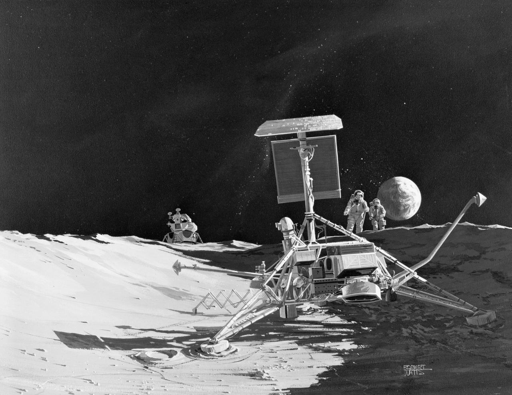  
*Figure 7.7: Surveyor 3 robotic lander resting inside its crater on the Ocean of Storms, photographed by Apollo 12 astronauts.*  
*Image Credit: NASA / Apollo 12 / Charles Conrad / Jet Propulsion Laboratory*

| Attribute | Verified NASA Mission Specification |
| :--- | :--- |
| **Official Machine Name** | Surveyor 3 |
| **Mission Name** | Surveyor Program (Surveyor 3) |
| **NASA Program / Agency** | NASA Surveyor Program / Jet Propulsion Laboratory & Hughes Aircraft |
| **Launch Date** | April 17, 1967 (Atlas-Centaur) |
| **Landing Date** | April 20, 1967 (Oceanus Procellarum) |
| **Landing Coordinates** | -3.0183° S, -23.3972° E (Ocean of Storms) |
| **Operational Lifespan** | Operated until May 3, 1967 (first lunar nightfall; returned 6,315 television images) |
| **Current Operational Status** | Resting inside Surveyor Crater; remaining structural frame visited by Apollo 12 astronauts; camera and scoop on display at the National Air and Space Museum. |

#### 1. Scientific Purpose & Mission Rationale
Demonstrate soft lunar landing capability using closed-loop radar altimetry and throttleable vernier engines; photograph the terrain; dig mechanical trenches with an electric scoop to measure soil bearing strength and cohesiveness prior to Apollo crewed missions.

#### 2. Primary Instruments & Payload Capabilities
Vidicon Television Camera with rotating mirror and color filters; Surface Sampler Scoop (electric pantograph arm capable of digging, scraping, and trenching); accelerometers, strain gauges, and thermal sensors.

#### 3. Key Scientific Discoveries & Achievements
Dug four surface trenches up to 17.5 cm deep; conducted bearing and shear strength tests proving that lunar regolith has the mechanical bearing capacity to support the landing weight of a crewed Apollo Lunar Module without catastrophic sinking; returned 6,315 high-resolution television images of crater slopes and rock textures.

#### 4. Reason Left Behind & Operational Termination
Surveyor 3 was designed as a single-lunar-day robotic proof-of-concept lander. When the brutal, two-week lunar night fell on May 3, 1967, solar power ceased and battery freezing disabled the craft. In November 1969, Apollo 12 landed 180 meters away; astronauts walked to the silent probe, cut away its television camera and sampling scoop, and brought them back to Earth. Controversial analysis later detected Streptococcus mitis bacteria on foam insulation, sparking intense astrobiological debate over microbial survival in deep-space vacuum.

#### 5. Historical & Scientific Significance
The only robotic spacecraft ever visited and partially retrieved by human explorers on another celestial body. Paved the runway for human footsteps on the Moon.

#### 6. Contribution to Lunar & Planetary Exploration
Conclusively validated that lunar regolith could support human landers and gave humanity its first long-term material exposure baseline from another world.

---

## 8. Comparative Analysis — Mars vs. The Moon

The exploration of the Moon and Mars represents two fundamentally distinct engineering paradigms dictated by celestial mechanics, atmospheric physics, communication latency, and planetary evolution.

### 8.1 Comprehensive Comparative Matrix

| Evaluation Dimension | The Moon (Lunar Exploration) | Mars (Martian Exploration) |
| :--- | :--- | :--- |
| **Exploration History** | 1959–present. Pioneered by Luna, Ranger, and Surveyor probes. Six crewed Apollo landings (1969–1972) placed 12 humans on the surface. Resumed modern robotic exploration with Clementine, Prospector, LRO, and Artemis. | 1960–present. Early Mariner flybys/orbiters paved the way. First successful soft landing achieved by Viking 1 in 1976. Continuous surface robotic exploration since Pathfinder (1997) through MER, Phoenix, Curiosity, InSight, and Perseverance. |
| **Major NASA Missions** | Surveyor 1–7, Lunar Orbiter 1–5, Apollo 11–17, Clementine, Lunar Prospector, LCROSS, Lunar Reconnaissance Orbiter (LRO), Artemis Program. | Mariner 4/9, Viking 1 & 2, Mars Pathfinder, Mars Odyssey, Mars Exploration Rovers (Spirit & Opportunity), Mars Reconnaissance Orbiter (MRO), Phoenix, Curiosity (MSL), MAVEN, InSight, Mars 2020 (Perseverance & Ingenuity). |
| **Types of Abandoned Hardware** | Lunar Module Descent Stages (Apollo 11–17), electric Lunar Roving Vehicles (Apollo 15–17), nuclear ALSEP scientific stations, crash-impact ascent stages and rocket S-IVB boosters, robotic landers (Surveyor 3). | Stationary landers (Viking 1 & 2, Pathfinder, Phoenix, InSight), mobile robotic rovers (Sojourner, Spirit, Opportunity; future Curiosity and Perseverance), autonomous rotorcraft (Ingenuity), discarded sky cranes, heat shields, backshells, and parachutes. |
| **Primary Scientific Objectives** | Determine the origin and differentiation of the Earth-Moon system; confirm the magma ocean hypothesis; date the Late Heavy Bombardment cratering chronology; measure solar wind particles and cosmic rays. | Astrobiological search for fossil biosignatures and past habitability; reconstruct the ancient hydrological cycle (paleolakes, river deltas, groundwater); measure atmospheric escape and loss; map deep planetary seismology; cache core samples for Earth return. |
| **Environmental Challenges** | Hard vacuum (10^-12 torr); extreme thermal swings (-180 °C to +120 °C); unattenuated micrometeorite bombardment; direct solar cosmic radiation; electrostatic, razor-sharp abrasive dust adhering to mechanisms. | Thin, carbon dioxide atmosphere (6–10 mbar, ~0.6% Earth sea-level); severe cold (-125 °C to +20 °C); global dust storms blocking sunlight for months; abrasive dust devils; dry-ice frost deposition; lower gravity (0.38 g vs Moon 0.166 g). |
| **Communication & Control** | Distance: ~384,400 km. One-way signal delay of only 1.28 seconds. Enables real-time conversational voice communication, direct live television broadcasts, and low-latency joystick teleoperation from Earth. | Distance: 54.6 million to 401 million km. One-way light travel time ranges from 3 to 22 minutes. Real-time manual driving is physically impossible. Requires high levels of onboard autonomy, hazard avoidance, and reliance on orbital relay satellites. |
| **Operational Lifespans** | Crewed Apollo stays were brief (21.5 to 75 hours). Robotic Surveyor survived days to weeks. Nuclear ALSEP stations operated continuously for up to 8 years before being shut down from Earth in 1977. | Extreme longevity achieved through robotic durability. Viking 1 operated over 6 years. Spirit operated over 6 years. Opportunity operated nearly 15 years (45 km). Curiosity is active after 12+ years. Ingenuity flew for nearly 3 years. |
| **Key Scientific Contributions** | Proved planetary differentiation and the giant impact hypothesis; provided the cosmic crater-density chronology that calibrates the age of every planetary surface in the solar system; enabled continuous laser ranging. | Proved ancient Mars possessed warm, neutral, freshwater lakes and active river systems; discovered organic carbon building blocks; revealed modern atmospheric water frost and active seismology; verified off-world aerodynamic flight. |

### 8.2 In-Depth Analysis of Commonalities and Contrasts

#### 1. The Survival Dilemma: Thermal Swings vs. Dust Accumulation
On the Moon, spacecraft face an unattenuated hard vacuum. The primary existential threat is the brutal two-week lunar night, during which temperatures plummet to -180 °C, freezing chemical batteries and solid-state electronics unless sustained by radioisotope heater units (RHUs) or RTGs. Conversely, on Mars, while the thin atmosphere buffers thermal extremes slightly (-125 °C to +20 °C), it introduces airborne dust. Planet-encircling dust storms deprive solar-powered rovers (Opportunity, InSight) of sunlight, choking their arrays and eventually causing power starvation.

#### 2. Communication Latency and Autonomy
The 1.3-light-second delay to the Moon allowed mission control in Houston to talk directly with astronauts in conversational real time and teleoperate the Lunar Roving Vehicle camera during liftoff. On Mars, the 3-to-22-minute one-way communication latency renders real-time joystick control physically impossible. Every Martian rover must possess onboard machine vision, terrain hazard assessment, and autonomous drive planners to navigate safely.

#### 3. Hardware Preservation and Archaeological Context
Because the Moon has no atmosphere, water, or wind, lunar equipment experiences zero chemical corrosion or physical weathering, altered only by micrometeorite impacts and solar radiation darkening. The Apollo 11 descent stage will stand virtually unchanged at Tranquility Base for millions of years. On Mars, while corrosion is minimal in the arid cold, active wind cycles, sand abrasion, and dust sedimentation slowly coat and bury landed machines, gradually incorporating them into the Martian geological stratum.

---

## 9. Interactive Storytelling & Voice Synchronization System

The interactive storytelling player in Beyond the Mission transforms static museum visits into short, emotionally resonant space documentaries. Rather than presenting conventional slideshows, the system employs a production-grade multi-layer media engine.

### 9.1 Core Architectural Principles
1. **Uninterrupted Voice-Over:** Audio narration is treated as the primary clock. Slides never advance based on arbitrary timers. A slide remains visible until its narration audio finishes naturally (`audio.onended`), ensuring no sentence is clipped.
2. **Dual-Buffer Zero-Black-Frame Presentation:** Two fullscreen image layers (`prevSlide` and `currentSlide`) crossfade simultaneously over 750 milliseconds, eliminating any flicker or blank frames.
3. **Continuous Ken Burns Camera Motion:** Images subtly pan and zoom using CSS transforms (`zoom-in`, `zoom-out`, `pan-left`, `pan-right`) with randomized transform origins, bringing historical archival photographs to life.
4. **Single-Line Progressive Subtitles:** Full paragraphs are split into individual sentences using regex punctuation guards that protect decimal numbers (e.g. `10.6`) and abbreviations (e.g. `U.S.`). Sentences transition sequentially in real time based on speech duration thresholds.
5. **Synchronized Red Progress Bar:** A thin red progress bar along the bottom edge tracks actual playback progress smoothly from 0% to 100%.
6. **Click-Anywhere Pause/Resume:** Clicking anywhere on the screen toggles playback, immediately pausing both the Web Audio stream and the Ken Burns animation. Clicking again resumes from the exact previous millisecond.
7. **Minimalist HUD:** The only persistent visible control is a transparent **← RETURN** button in the upper-left corner, preserving full immersion.

---

## 10. User Interface & User Experience Design

### 10.1 Visual Philosophy
The user interface follows a **deep-space editorial aesthetic** characterized by restraint, high legibility, and architectural glassmorphism:
- **Color Palette:**
  - Background: Deep cosmic black (`#000000` / `#080c14`) paired with high-resolution persistent space backdrops.
  - Typography: Crisp pure white (`#FFFFFF`) for primary headings; muted silver (`#B8B8B8`) for telemetry and coordinates.
  - Accents: Deep space red (`#d9383a`) for audio progress; subtle cyan/blue (`#2f81f7`) for celestial badges.
  - Glass Surfaces: `rgba(0, 0, 0, 0.35)` with `backdrop-filter: blur(16px)` and delicate 1px borders (`rgba(255, 255, 255, 0.08)`).
- **Typography:** **Space Grotesk** is used across all machine callouts, museum headers, and dossier cards. Its geometric sans-serif proportions evoke aerospace technical consoles while maintaining readability.

### 10.2 Responsive Engineering
The interface is constructed using standard `100dvh` (dynamic viewport height) and `env(safe-area-inset-top)` / `env(safe-area-inset-bottom)` constraints, ensuring that navigation bars, dossiers, and storytelling overlays never overflow on modern mobile screens with notches or dynamic home bars.

---

## 11. Technical Architecture & Engineering Implementation

### 11.1 Technology Stack Summary
- **Framework:** Next.js 16.4.6 with Turbopack & React 19 Strict Mode.
- **Language:** TypeScript 5.8 (Strict type checking, zero `any` types).
- **3D Graphics Engine:** Three.js 0.187.0 via `@react-three/fiber` and `@react-three/drei`.
- **Styling:** Tailwind CSS 3.4.17 with custom hardware-accelerated animations.
- **Audio & Speech:** HTML5 Web Audio API + Voice Studio Local TTS REST API (`/api/narration`).
- **State Management:** Custom lightweight pub/sub stores (`cursorStore`) and React 19 `useSyncExternalStore` hooks.

### 11.2 High-Level Architecture Diagram
```
+---------------------------------------------------------------------------------+
|                               CLIENT BROWSER                                    |
|                                                                                 |
|  +---------------------------------------------------------------------------+  |
|  |                            NEXT.JS APP ROUTER                             |  |
|  |   - RootLayout (app/layout.tsx): Persistent deep-space backdrop           |  |
|  |   - Landing Page (app/page.tsx): Hero typography & transition CTA         |  |
|  |   - ExperienceRoot (app/experience/page.tsx): Client-side hydration guard |  |
|  +---------------------------------------------------------------------------+  |
|                                       |                                         |
|                                       v                                         |
|  +---------------------------------------------------------------------------+  |
|  |                        EXPERIENCE CONTROLLER CANVAS                       |  |
|  |   - Canvas (Three.js WebGL Renderer, ACESFilmicToneMapping, exposure 1.15)|  |
|  |   - CameraController: Smooth Vector3 lerp transitions & bounding          |  |
|  |   - OrbitControls: Inertial damping (0.08), touch support                 |  |
|  |   - DynamicFocusLighting: Adaptive key, fill, and ambient illumination    |  |
|  +---------------------------------------------------------------------------+  |
|             |                                                |                  |
|             v                                                v                  |
|  +-----------------------+                      +----------------------------+  |
|  |  3D SCENE MODULES     |                      |  2D GLASSMORPHIC OVERLAYS  |  |
|  | - SolarSystem Engine  |                      | - Liquid Glass Sidebar     |  |
|  | - Moon Albedo Sphere  |                      | - PlanetInfoPanel Dossier  |  |
|  | - Mars Surface Sphere |                      | - Machine Dossier Cards    |  |
|  | - DynamicCallouts     |                      | - Dynamic HTML Tooltips    |  |
|  | - MarsCallouts        |                      | - Custom SVG Cursor Store  |  |
|  +-----------------------+                      +----------------------------+  |
|             |                                                |                  |
|             +-----------------------+------------------------+                  |
|                                     |                                           |
|                                     v                                           |
|  +---------------------------------------------------------------------------+  |
|  |                      STORYTELLING VIEW SUBSYSTEM                          |  |
|  |   - Dual-buffer Image Renderer (Ken Burns CSS keyframes)                  |  |
|  |   - Web Audio Synchronization Clock (50ms interval loop)                  |  |
|  |   - Progressive Sentence Splitting & Word-ratio Thresholds               |  |
|  |   - Red Progress Track & Click-anywhere Play/Pause State Machine          |  |
|  +---------------------------------------------------------------------------+  |
|                                     |                                           |
+-------------------------------------|-------------------------------------------+
                                      | HTTP REST (/api/narration)
                                      v
+---------------------------------------------------------------------------------+
|                       NEXT.JS SERVER / BACKEND ROUTE                            |
|  - GET /api/narration?action=health: Voice Studio health & model probe          |
|  - POST /api/narration: Synthesize narration via local Voice Studio endpoint   |
+---------------------------------------------------------------------------------+
                                      | HTTP Proxy
                                      v
+---------------------------------------------------------------------------------+
|                  VOICE STUDIO LOCAL SERVICE (Port 3900/v1)                      |
|  - Storytelling Mode Active | Middle-aged Low-Pitch Narrator                   |
|  - Models: tts-1, tts-1-hd, whisper-1, omnivoice                                |
+---------------------------------------------------------------------------------+
```

---

## 12. Development Process & Production Workflow

The development of Beyond the Mission was executed across five structured engineering sprints:
1. **Concept & Challenge Selection:** Selected the NASA Space Apps Challenge *Abandoned but not Forgotten*, identifying the urgent need to preserve landed planetary equipment.
2. **Data Curation & Verification:** Cataloged all 16 landed NASA machines on the Moon and Mars from primary NASA mission reports, NSSDCA records, and LRO/MRO orbital datasets.
3. **3D Scene Engineering:** Developed the unified Solar System simulation and dedicated Moon/Mars planetary globes using React Three Fiber. Engineered the straight white laser callout system with limb hysteresis to eliminate label flickering.
4. **Cinematic Storytelling Integration:** Formatted authentic voice-over documentary scripts and archival photography into a master database (`lib/stories-data.ts`). Built the dual-buffer crossfading player with single-line synchronized subtitles.
5. **Quality Assurance & Optimization:** Conducted comprehensive static analysis audits, resolving 26 React 19 Compiler and ESLint errors. Optimized WebGL scratch vectors to achieve a sustained 60 FPS across desktop and mobile devices.

---

## 13. Educational Impact & Scientific Outreach

Beyond the Mission serves as a versatile digital resource across multiple educational tiers:
- **K-12 Students:** Engages young learners through interactive 3D exploration and bite-sized documentary stories that humanize space science.
- **University Students & Academics:** Provides an accurate geographic reference for historical landing sites, complete with verified coordinates, mission timelines, and instrumental payloads.
- **Museums & Educators:** Serves as an interactive digital exhibit for classroom projection or touch-screen science center kiosks.
- **General Public:** Inspires a broader appreciation for the immense engineering sacrifices that paved humanity's path into deep space.

---

## 14. Future Roadmap & Extensibility

1. **Expanded Planetary Destinations:** Add dedicated exploration museums for Venus (Soviet Venera/Vega landers and NASA Pioneer probes), Titan (Huygens lander), and the asteroid belt (NEAR Shoemaker at Eros, Dawn at Vesta/Ceres).
2. **Additional Historic Equipment:** Incorporate human orbital discard artifacts, including Apollo ascent stages, orbital crash sites, and Soviet lunar rovers (Lunokhod 1 and 2).
3. **Multilingual Storytelling:** Support real-time narration in multiple languages (Spanish, French, Arabic, Urdu, Mandarin) through Voice Studio multilingual models.
4. **WebXR / Virtual Reality Mode:** Enable WebXR device support to allow users to walk on the virtual lunar and Martian surfaces beside the Apollo Lunar Module or Curiosity rover using VR headsets.

---

## 15. References, Data Sources & Image Credits

See the companion document [`Beyond_the_Mission_References.md`](file:///documentation/Beyond_the_Mission_References.md) for the complete, annotated academic bibliography, official NASA mission repository links, and visual asset credits.
